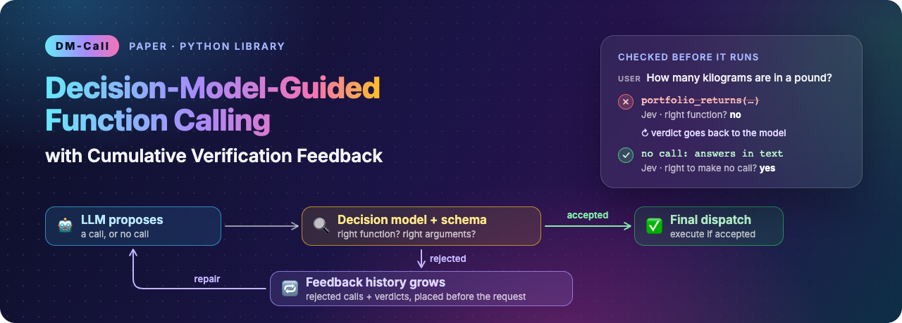
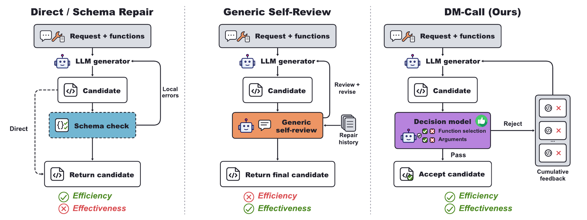

<p align="center">
  
</p>

<p align="center">
  <a href="https://arxiv.org/abs/2611.10977"></a>
  <a href="#languages"></a>
  <a href="typescript/"></a>
  <a href="go/"></a>
  <a href="rust/"></a>
  <a href="java/"></a>
  <a href="LICENSE"></a>
</p>

<p align="center">
  
  
  
  
  
  
  
  
</p>

<p align="center">
  <a href="#how-it-works"><b>How it works</b></a> ·
  <a href="#see-it"><b>See it</b></a> ·
  <a href="#languages"><b>Languages</b></a> ·
  <a href="#quickstart"><b>Quickstart</b></a> ·
  <a href="#decision-models"><b>Decision models</b></a> ·
  <a href="#verify-calls-from-any-framework"><b>Verify</b></a> ·
  <a href="#results"><b>Results</b></a> ·
  <a href="#citation"><b>Citation</b></a>
</p>

<h2 align="center">Two questions before any tool call runs</h2>

<p align="center"><b>Is this the right function? Are these the right arguments?</b></p>

A decision model answers both. A rejected call goes back to the LLM with every earlier attempt and its scores.

```diff
  User: how to cook sikhae
- HNA_WQA_search(keyword="how to make sikhae Korean sweet rice drink recipe")
-   right function? 0.37 ✗    right arguments? 0.94 ✓
-   → rejected and sent back with its scores
+ cookbook_search_recipe(keyword="sikhae")
+   right function? 0.93 ✓    right arguments? 0.95 ✓
+   → accepted
```

```python
import dmcall

agent = dmcall.DMCall("openai:gpt-5-nano", tools=[get_weather, book_table])
agent.run("Is it jacket weather in Seoul tonight?")  # runs only an accepted call
```

> [!TIP]
> Already have an agent? Keep it. `dmcall.verify(messages, tool_calls, tools)` checks calls from the OpenAI, Anthropic or Google SDKs before you execute them. [Jump there](#verify-calls-from-any-framework).

<p align="center">
  <a href="https://github.com/gogoymh/decision-model-guided-function-calling"></a>
</p>

## How it works

A function call can be valid JSON and still be wrong. The model picks the wrong function, fills in a value nobody gave, or calls a tool when none applies, and a JSON schema passes all three. DM-Call puts a decision model between the model and your code. For each proposed call, the decision model returns the probability that the function is right and the probability that the arguments are right.

<p align="center">
  
</p>

Given a request $x$ and the available functions $\mathcal{F}$, DM-Call returns one next action: a call $c=(f,a)$ or no call. It separates an LLM **generator** $G$, which proposes candidates, from a **decision model** $D$, which verifies them. Each step below follows Section 2 of the paper.

1. **Propose.** At step $t$ the generator proposes $c_t$ from the request, the function schemas and the history $H_t$ of rejected candidates.
2. **Verify.** A local schema check $S(c_t)$ tests that the candidate is readable, names an available function and supplies every required argument with its declared type. The decision model asks the function question $D_f$ and, when there is a call, the argument question $D_a$, each returning $p \in [0,1]$. A question that is not asked has the null score $\bot$.
3. **Accept.** $c_t$ is accepted when $S(c_t)$ holds and every asked question scores at least 0.5. A readable candidate that fails $S$ is still judged, so its feedback carries both the schema errors and the scores.
4. **Repair.** A rejected candidate and its feedback $d_t$ join $H$, which the generator reads oldest first, marked as not executed, before the unchanged original request. The decision model sees only the request, the schemas and the current candidate.
5. **Return.** The loop returns the first accepted candidate. If none of $c_0, \dots, c_r$ is accepted, it returns $c_0$. A parseable initial no call is returned without verification and marked as unverified; an unparseable output is never treated as a no call.

**Hybrid feedback.** The feedback record $d_i$ holds the two scores, the two verdicts and the schema result with its errors. Hybrid feedback keeps each probability and adds a label from five equal-width bands: *very likely incorrect* (below 0.2), *likely incorrect*, *uncertain*, *likely correct* and *very likely correct* (0.8 or more). The labels change only what the generator reads; acceptance still uses the numeric score, so 0.48 and 0.52 are both *uncertain*, yet only 0.52 passes.

Nothing is executed during verification or repair. `call()` returns the decision, and `run()` executes only an accepted call.

## See it

Four trajectories from the paper (Table 4). Each candidate shows the decision model's scores for the function question and the argument question; a check passes at 0.5. Red candidates were rejected and sent back to the model, and green ones were accepted.

#### (a) The wrong function is replaced
`claude-sonnet-5.5` · BFCL
> how to cook sikhae

```diff
- t=0  HNA_WQA_search(keyword="how to make sikhae
-        Korean sweet rice drink recipe")
-      function 0.37 ✗   arguments 0.94 ✓   → rejected
+ t=1  cookbook_search_recipe(keyword="sikhae")
+      function 0.93 ✓   arguments 0.95 ✓   → accepted
```

Only the function question fails, so the model keeps the keyword and moves from web search to the recipe tool.

#### (b) A wrong argument value is corrected
`gpt-5.4-mini` · BFCL
> Find me the best Italian restaurants in New York City with average customer ratings of more than 4 and accepts credit cards.

```diff
- t=0  restaurant_search(accepts_credit_cards=true,
-        cuisine="Italian", location="New York City, NY",
-        rating=5)
-      function 0.94 ✓   arguments 0.19 ✗   → rejected
+ t=1  restaurant_search(..., rating=4)
+      function 0.96 ✓   arguments 0.57 ✓   → accepted
```

Only the argument question fails, and the model lowers the minimum rating to the requested 4. The repair passes at 0.57, which Hybrid feedback labels *uncertain*.

#### (c) An unnecessary call is withdrawn
`gpt-5-nano` · BFCL, with only a tax calculator available
> 马斯克是谁 ("Who is Musk?")

```diff
- t=0  calculate_tax(filing_status="single", income=0)
-      function 0.03 ✗   arguments 0.12 ✗   → rejected
+ t=1  no call: answers in text
+      function 0.97 ✓   (no argument question) → accepted
```

Both scores are near zero, and the model answers in text instead of calling a tool.

#### (d) Several repairs reach the right call
`gpt-5-nano` · API-Bank
> **User:** Can you help me delete my account?<br>
> **Assistant:** Sure, I can help with that. Can you provide your username and password?<br>
> **User:** My username is "foo", password is "bar".<br>
> **Assistant:** Alright, let me check if the token you provided is valid.

```diff
- t=0  CheckToken(token="")
-      function 0.28 ✗   arguments 0.07 ✗   → rejected
- t=1  CheckToken(token="")
-      function 0.33 ✗   arguments 0.06 ✗   → rejected
- t=2  DeleteAccount(token="")
-      function 0.43 ✗   arguments 0.06 ✗   → rejected
+ t=3  GetUserToken(username="foo", password="bar")
+      function 0.84 ✓   arguments 0.96 ✓   → accepted
```

The model calls `CheckToken` with an empty token twice and then tries to delete the account with it. Only at the third repair does it request a token with the user's credentials.

## Languages

DM-Call is available in five languages. Every implementation sends the same requests, byte for byte: each one passes the shared conformance suite in [`spec/`](spec/), which includes the requests recorded from the code behind the paper's tables. They share the same defaults, options and decision models.

| Language | Folder | Install | Requires |
|---|---|---|---|
| Python | [`src/dmcall`](src/dmcall) | `pip install "git+https://github.com/gogoymh/decision-model-guided-function-calling.git"` | Python 3.11+ |
| TypeScript / JavaScript | [`typescript/`](typescript/) | build from the repo, then `npm install` the package ([how](typescript/README.md#install)) | Node 18+ |
| Go | [`go/`](go/) | `go get github.com/gogoymh/decision-model-guided-function-calling/go` | Go 1.22+ |
| Rust | [`rust/`](rust/) | `dmcall = { git = "https://github.com/gogoymh/decision-model-guided-function-calling" }` | Rust 1.85+ |
| Java / Kotlin | [`java/`](java/) | `cd java && mvn install`, then `io.github.gogoymh:dmcall:1.0.0` ([how](java/README.md#build-and-install-from-the-repository)) | Java 17+ |

The packages are not on PyPI, npm, crates.io or Maven Central yet; the commands above install from this repository. The rest of this README uses Python. Each language folder has a README with the same sections in that language.

<details>
<summary><b>TypeScript</b></summary>

```ts
import { DMCall, tool } from "dmcall";

const getWeather = tool({
  name: "get_weather",
  description: "Current weather for a city.",
  parameters: { type: "object", properties: { city: { type: "string" } }, required: ["city"] },
  execute: async ({ city }) => ({ city, temp: 12 }),
});

const agent = new DMCall("openai:gpt-5-nano", { tools: [getWeather], reasoningEffort: "none" });
const result = await agent.run("Do I need a jacket in Seoul tonight?");
console.log(result.call, result.accepted, result.output);
```

</details>

<details>
<summary><b>Go</b></summary>

```go
package main

import (
	"context"
	"fmt"
	"log"

	dmcall "github.com/gogoymh/decision-model-guided-function-calling/go"
)

type weatherArgs struct {
	City string `json:"city"`
}

func main() {
	weather := dmcall.Tool{
		Name:        "get_weather",
		Description: "Current weather for a city.",
		Parameters: dmcall.MustParseJSON(`{"type": "object",
			"properties": {"city": {"type": "string"}}, "required": ["city"]}`),
		Handler: dmcall.TypedHandler(func(ctx context.Context, in weatherArgs) (map[string]any, error) {
			return map[string]any{"city": in.City, "temp": 12}, nil
		}),
	}
	generator, err := dmcall.NewOpenAI("gpt-5-nano", dmcall.WithReasoningEffort("none"))
	if err != nil {
		log.Fatal(err)
	}
	client, err := dmcall.New(generator, dmcall.WithTools(weather))
	if err != nil {
		log.Fatal(err)
	}
	result, err := client.Run(context.Background(), dmcall.Prompt("Do I need a jacket in Seoul tonight?"))
	if err != nil {
		log.Fatal(err)
	}
	fmt.Println(result) // Result(call=get_weather(city="Seoul"), accepted=True, repairs=0, output=...)
}
```

</details>

<details>
<summary><b>Rust</b></summary>

```rust
use dmcall::{DMCall, OpenAI, Tool};
use serde_json::json;

fn main() -> dmcall::Result<()> {
    let weather = Tool::function(
        "get_weather",
        "Current weather for a city.",
        json!({"type": "object", "properties": {"city": {"type": "string"}}, "required": ["city"]}),
    )?
    .with_handler(|arguments| Ok(json!({"city": arguments["city"], "temp": 12})));

    let agent = DMCall::builder(OpenAI::new("gpt-5-nano")?).tool(weather).build()?;
    let result = agent.run("Do I need a jacket in Seoul tonight?")?;
    println!("{result}");
    Ok(())
}
```

</details>

<details>
<summary><b>Java</b></summary>

```java
import io.github.gogoymh.dmcall.*;

Tool weather = Tool.function("get_weather", "Current weather for a city.", Json.parse("""
        {"type": "object", "properties": {"city": {"type": "string"}}, "required": ["city"]}
        """), arguments -> "12 degrees in " + arguments.get("city").asText());

try (DMCall agent = DMCall.builder("openai:gpt-5-nano").tools(weather).build()) {
    Result result = agent.run("Do I need a jacket in Seoul tonight?");
    System.out.println(result.call() + " " + result.accepted() + " " + result.output());
}
```

</details>

For any other language, or an agent you do not want to change, call the decision model's HTTP API around your own loop, or use [`verify`](#verify-calls-from-any-framework) from one of these packages.

## Install

Python 3.11 or newer. For the other languages, see [Languages](#languages).

```bash
pip install "git+https://github.com/gogoymh/decision-model-guided-function-calling.git"
```

or, from a clone, `pip install -e .` (or `uv sync`). The library depends only on `httpx` and `jsonschema`.

Set the keys for the decision model and for your model provider:

```bash
export TYPESAFE_API_KEY=...   # Jev, the default decision model (https://console.typesafe.ai)
export OPENAI_API_KEY=...     # or ANTHROPIC_API_KEY, GEMINI_API_KEY, XAI_API_KEY, ...
```

## Quickstart

```python
import dmcall

def get_weather(city: str, unit: str = "celsius") -> dict:
    """Current weather for a city.

    Args:
        city: City name, e.g. "Seoul".
        unit: "celsius" or "fahrenheit".
    """
    return {"city": city, "temp": 12, "unit": unit}

agent = dmcall.DMCall("openai:gpt-5-nano", tools=[get_weather], reasoning_effort="none")

result = agent.run("Do I need a jacket in Seoul tonight?")
result.call       # {"name": "get_weather", "arguments": {"city": "Seoul"}}
result.accepted   # True: the schema check and both questions passed
result.output     # {"city": "Seoul", "temp": 12, "unit": "celsius"}
result.repairs    # repairs it took (0 to 3)
```

`run()` executes the final call only if it was accepted. `call()` does everything except execute, so you decide:

```python
result = agent.call("Book a table for two at 7pm")
if result.accepted:
    ...                                  # run result.call yourself
elif result.no_call:
    print(result.text)                   # the model answered without a tool
```

## Use any model

The generator is a `"provider:model"` string or a provider object. Other keyword options (`api_key=`, `base_url=`, `reasoning_effort=`, ...) go to the provider.

```python
dmcall.DMCall("openai:gpt-5-nano", reasoning_effort="none")   # OPENAI_API_KEY
dmcall.DMCall("anthropic:claude-sonnet-5-5")                    # ANTHROPIC_API_KEY
dmcall.DMCall("gemini:gemini-2.5-flash")                        # GEMINI_API_KEY or GOOGLE_API_KEY
dmcall.DMCall("meta:muse-spark-1.3")                            # MODEL_API_KEY (Meta Model API)
dmcall.DMCall("xai:grok-4")                                     # XAI_API_KEY
dmcall.DMCall("openrouter:meta-llama/llama-3.3-70b-instruct")   # OPENROUTER_API_KEY
dmcall.DMCall("azure:my-deployment", endpoint="https://my-resource.openai.azure.com")  # AZURE_OPENAI_API_KEY

# A local or self-hosted model behind an OpenAI-compatible server (vLLM, Ollama, LM Studio, ...)
dmcall.DMCall(dmcall.OpenAICompatible("gemma-4-31b-it", base_url="http://localhost:8000/v1"))
```

| Provider | Spec | Key | Class |
|---|---|---|---|
| OpenAI | `openai:<model>` | `OPENAI_API_KEY` | `dmcall.OpenAI` |
| Anthropic | `anthropic:<model>` | `ANTHROPIC_API_KEY` | `dmcall.Anthropic` |
| Google Gemini | `gemini:<model>` | `GEMINI_API_KEY` or `GOOGLE_API_KEY` | `dmcall.Gemini` |
| Meta Model API (Muse) | `meta:<model>` | `MODEL_API_KEY` | `dmcall.Meta` |
| xAI Grok | `xai:<model>` | `XAI_API_KEY` | `dmcall.XAI` |
| Azure OpenAI | `azure:<deployment>` | `AZURE_OPENAI_API_KEY` and `AZURE_OPENAI_ENDPOINT` | `dmcall.AzureOpenAI` |
| OpenRouter | `openrouter:<model>` | `OPENROUTER_API_KEY` | `dmcall.OpenRouter` |
| Any OpenAI-compatible server | | optional | `dmcall.OpenAICompatible` |

Provider objects take `max_output_tokens` (4,096 by default), `temperature`, `system_prompt`, `timeout`, `max_retries` and `headers`; OpenAI-style providers also take `reasoning_effort`, and Gemini takes `thinking_budget`. A response that is cut off, filtered or refused is an unreadable candidate: it is rejected and repaired, never read as "no call". Any object with `generate(example, history)` that returns `{"calls": ..., "content": ...}` can stand in for a provider. `dmcall.SYSTEM_PROMPT` is the generator prompt used in the paper.

Meta's Muse models reject `reasoning_effort="none"` and accept only `tool_choice="auto"`, so `dmcall.Meta` sends neither `reasoning_effort` nor `parallel_tool_calls` unless you set them. Muse models were not evaluated in the paper.

## Decision models

The decision model answers the two questions. Pass a configured one as `decision_model=`.

```python
dmcall.DMCall("openai:gpt-5-nano")   # Jev with threshold 0.5 (TYPESAFE_API_KEY)

jev = dmcall.Jev(api_key="...", threshold=0.5, model="jev-1.13.0")
dmcall.DMCall("openai:gpt-5-nano", decision_model=jev)

pplx = dmcall.PPLXDecider("http://localhost:8000")
dmcall.DMCall("openai:gpt-5-nano", decision_model=pplx)
```

- **`dmcall.Jev`** is TypeSafe's hosted decision model; the paper uses `jev-1.13.0`. `threshold` sets both questions, and `function_threshold` or `arguments_threshold` overrides one.
- **`dmcall.PPLXDecider`** is the open-weight [Perplexity Decider v1.1 27B](https://huggingface.co/perplexity-ai/pplx-decider-v1.1-27b), served on your own machine. The paper used revision `14c9d90137962d300f3de95633f7b6535e80c5ce` in BF16 through the checkpoint's own native inference server, which applies its calibration temperature (1.009) and answers `POST /v1/systemone`. A generic causal chat server is not this model. Plain HTTP is accepted only for `localhost`; use HTTPS or an SSH tunnel otherwise. `check_provenance=True` makes the client confirm the pinned checkpoint through a `GET /provenance` route first (the paper's runs added that route with a small deployment wrapper).
- **Your own decision model**: subclass `dmcall.DecisionModel` and override `ask(state, questions)` to return a probability of yes for each question. The questions are `dmcall.FUNCTION_QUESTION` and `dmcall.ARGUMENT_QUESTION`.

Both decision models see only the conversation, the function schemas and the candidate; no reference answer is sent.

## Tools

Plain functions work as they are: parameter types come from type hints (`str`, `int`, `float`, `bool`, `list[...]`, `dict[...]`, `Literal`, `Enum`, `Optional`, `TypedDict`, `Annotated[..., "description"]`), descriptions from Google, NumPy or Sphinx docstrings, and defaults from the signature. Use the decorator to override anything, or pass JSON Schema definitions in OpenAI, Anthropic or Gemini format:

```python
@dmcall.tool(name="weather", description="Current weather for a city.")
def get_weather(city: str, unit: Literal["celsius", "fahrenheit"] = "celsius") -> dict: ...

schema = {"type": "function", "function": {
    "name": "search", "description": "Search the web.",
    "parameters": {"type": "object", "properties": {"query": {"type": "string"}}, "required": ["query"]}}}
agent = dmcall.DMCall("openai:gpt-5-nano", tools=[get_weather, schema], functions={"search": my_search})
```

`dmcall.schema_of(fn)` shows the schema DM-Call sends, and `dmcall.check_schema(tools, calls)` runs the schema check $S$ alone.

## Verify calls from any framework

Keep your agent and check its calls before you execute them. `verify` takes the conversation so far (earlier tool calls and tool results included) and the proposed calls, as plain dicts or as the message and tool-call objects of the OpenAI, Anthropic and Google SDKs.

```python
from openai import OpenAI

response = OpenAI().chat.completions.create(model="gpt-5-nano", messages=messages, tools=tools)
verdict = dmcall.verify(messages, response.choices[0].message.tool_calls, tools)

if verdict:                       # passed the schema check and both questions
    execute(response.choices[0].message.tool_calls)
else:
    print(verdict.function_probability, verdict.arguments_probability, verdict.schema_errors)
    # verdict.feedback is the record DM-Call would send back to the model for a repair
```

## Options

```python
dmcall.DMCall(
    "openai:gpt-5-nano",
    tools=[...],
    decision_model=None,            # dmcall.Jev by default
    threshold=0.5,                  # pass mark of both questions (for the default Jev)
    max_repairs=3,                  # r: repairs after the first candidate
    checks="both",                  # "function" or "arguments": ask one question only
    history="cumulative",           # "latest": show only the latest rejected candidate
    feedback="hybrid",              # "numeric" or "text"
    on_exhaustion="first",          # if nothing is accepted: return c_0 ("last": the last repair)
    preserve_initial_no_call=True,  # return a readable first no call without verification
    execute_unverified=False,       # True: run() also executes the final candidate when none was accepted
)
```

The defaults are the paper's settings. The paper's variants map to options as follows.

| In the paper | Options |
|---|---|
| DM-Call | defaults |
| DM-Call-Function: function question only | `checks="function"` |
| DM-Call-Argument: argument question only | `checks="arguments"` |
| DM-Call-Latest: only the latest rejection as feedback | `history="latest"` |
| *Numeric* feedback, $\Phi(p)=p$ | `feedback="numeric"` |
| *Text* feedback, $\Phi(p)=\ell(p)$ | `feedback="text"` |
| *Hybrid* feedback, $\Phi(p)=(p,\ell(p))$ | `feedback="hybrid"` |

`call()` and `run()` also take `max_repairs=` and `on_exhaustion=` per request, and `acall`, `arun` and `averify` run the same steps in a worker thread for async code. The paper's baselines (Self-Refine, MAD-FC and PF-FC) ran in its experiment code and are not part of this library.

<details>
<summary><b>The result object</b></summary>

| Field | Meaning |
|---|---|
| `calls` | final candidate: `[{"name", "arguments"}]`, `[]` for no call, `None` if unreadable; $c_0$ when nothing was accepted (`on_exhaustion="first"`) |
| `call` | the first call, or `None` |
| `accepted` | passed every check (`None` for a first no call returned without verification) |
| `initial_no_call_preserved` | the first candidate was a readable no call, returned without verification |
| `exhausted` | reached the repair limit without an accepted candidate |
| `repairs` | repairs used |
| `final_attempt` | which candidate in `trace` is final (0: the first) |
| `text` | the model's text, e.g. its answer when it made no call |
| `executed`, `output` | whether `run()` executed the call, and what it returned |
| `attempts` | every candidate with its verdict, scores and schema errors |
| `probabilities` | the decision model's scores for the final candidate |
| `usage`, `latency_s` | tokens of the generator and of the decision model, and wall time |
| `trace` | the full record: candidates, judgments and the feedback the generator was given |

</details>

## Results

> [!NOTE]
> These are the results reported in the paper. Four generators (`gpt-5-nano`, `gpt-5.4-mini` and `claude-sonnet-5.5` through their APIs, and the open-weight `gemma-4-31b-it` in FP8, served locally with vLLM; reasoning effort `none` where supported and no thinking mode) and two decision models (the hosted Jev, `jev-1.13.0`, and the open-weight PPLX Decider v1.1 27B, run locally) were evaluated on 3,035 BFCL single-turn Python cases, scored by the official AST metric, and on an adapted API-Bank set of 156 first-call cases with a fixed 53-API catalog, scored by exact match of function names and type-normalized arguments. No API is executed. DM-Call uses threshold 0.5, at most three repairs ($r^\star=3$) and Hybrid feedback. These settings were chosen on the same benchmarks, without a held-out split.

**Main results** (the paper's Table 1): three-run mean accuracy (%). All methods except MAD-FC start from the same first Direct answer.

| BFCL | Direct | Self-Refine | MAD-FC | PF-FC | DM-Call (Jev) | DM-Call (PPLX) |
|---|---:|---:|---:|---:|---:|---:|
| `gpt-5-nano` | 64.12 | 69.45 | 63.53 | 74.54 | 74.63 | 74.24 |
| `gpt-5.4-mini` | 81.59 | 81.27 | 81.10 | 81.79 | 82.54 | 82.20 |
| `claude-sonnet-5.5` | 88.25 | 88.43 | 85.22 | 86.45 | 88.56 | 88.46 |
| `gemma-4-31b-it` | 86.67 | 86.69 | 84.91 | 84.85 | 86.91 | 86.88 |

| API-Bank (first call) | Direct | Self-Refine | MAD-FC | PF-FC | DM-Call (Jev) | DM-Call (PPLX) |
|---|---:|---:|---:|---:|---:|---:|
| `gpt-5-nano` | 61.32 | 58.55 | 66.03 | 70.09 | 64.32 | 64.53 |
| `gpt-5.4-mini` | 80.13 | 79.91 | 80.98 | 76.71 | 80.13 | 80.13 |
| `claude-sonnet-5.5` | 86.97 | 87.39 | 81.62 | 83.12 | 87.39 | 87.39 |
| `gemma-4-31b-it` | 81.41 | 81.41 | 82.48 | 77.56 | 81.62 | 81.41 |

Inference cost in USD for one run over the 3,035 BFCL cases, at list prices. Models run locally (`gemma-4-31b-it` and the PPLX Decider) are not priced.

| BFCL cost (USD) | Direct | Self-Refine | MAD-FC | PF-FC | DM-Call (Jev) |
|---|---:|---:|---:|---:|---:|
| `gpt-5-nano` | 0.167 | 0.762 | 1.493 | 5.903 | 0.525 |
| `gpt-5.4-mini` | 2.146 | 9.591 | 16.501 | 6.750 | 2.783 |
| `claude-sonnet-5.5` | 12.598 | 56.184 | 95.244 | 18.686 | 13.988 |

- On BFCL, DM-Call with Jev had the highest accuracy for all four generators. It gained 10.5 points over Direct with `gpt-5-nano`, 0.9 with `gpt-5.4-mini`, 0.3 with `claude-sonnet-5.5` and 0.2 with `gemma-4-31b-it`. With the PPLX Decider it stayed within 0.4 points of Jev.
- On API-Bank the gains were smaller. DM-Call led or tied only with `claude-sonnet-5.5`; PF-FC led with `gpt-5-nano`, and MAD-FC with `gpt-5.4-mini` and `gemma-4-31b-it`. Most API-Bank ties come from that shared first answer: apart from `gpt-5-nano`'s, the decision model rejected it in only 0 to 6 of the 156 cases per run, so DM-Call usually returned it unchanged.
- DM-Call with Jev cost 3.1, 1.3 and 1.1 times Direct with `gpt-5-nano`, `gpt-5.4-mini` and `claude-sonnet-5.5`. Self-Refine cost 1.5 to 4.0 times as much as DM-Call, PF-FC 1.3 to 11 times and MAD-FC 3 to 7 times.

**Verification and history** (Table 2): `gpt-5-nano` on BFCL with Jev, $r=3$, mean ± s.d. of three runs. These runs replay archived trajectories, so Direct here (64.11) differs slightly from Table 1 (64.12). *Args.* is argument accuracy given the correct function.

| Method | Call (%) | Func. (%) | Args. (%) |
|---|---:|---:|---:|
| Direct | 64.11 ± 0.31 | 75.11 ± 0.29 | 81.27 ± 0.14 |
| DM-Call-Function | 73.12 ± 0.46 | 83.84 ± 0.52 | 81.78 ± 0.07 |
| DM-Call-Argument | 73.61 ± 0.33 | 83.73 ± 0.52 | 82.64 ± 0.38 |
| DM-Call-Latest | 73.05 ± 0.24 | 83.61 ± 0.22 | 82.05 ± 0.16 |
| DM-Call | 74.32 ± 0.22 | 84.80 ± 0.26 | 82.18 ± 0.13 |

Every variant gained 8.9 to 10.2 points over Direct. Asking both questions gave the highest call accuracy, and DM-Call-Argument the highest argument accuracy. Showing only the latest rejection cost 1.3 points of call accuracy.

**Feedback representation** (Table 3): BFCL accuracy (%) at $r^\star=3$, three-run mean, from Table 1's first answers.

| Generator | Jev Numeric | Jev Text | Jev Hybrid | PPLX Numeric | PPLX Text | PPLX Hybrid |
|---|---:|---:|---:|---:|---:|---:|
| `gpt-5-nano` | 74.20 | 74.14 | 74.63 | 73.95 | 73.68 | 74.24 |
| `gpt-5.4-mini` | 82.45 | 82.47 | 82.54 | 82.22 | 82.26 | 82.20 |
| `claude-sonnet-5.5` | 88.53 | 88.57 | 88.56 | 88.45 | 88.46 | 88.46 |
| `gemma-4-31b-it` | 86.93 | 86.91 | 86.91 | 86.89 | 86.91 | 86.88 |
| Average | 83.03 | 83.02 | 83.16 | 82.88 | 82.83 | 82.95 |

Hybrid feedback helped most where repairs are frequent: `gpt-5-nano` repairs 24% of cases with Jev and 21% with the PPLX Decider, and there Hybrid led Numeric by 0.3 to 0.4 points and Text by 0.5 to 0.6. For the other generators (1% to 6% of cases repaired) the three representations were within 0.1 points. Hybrid had the highest average with both decision models and is the default.

**Repair budget** (Figure 2): `gpt-5-nano` on BFCL with Jev, three runs continued to ten repairs and cut at each $r$.


| $r$ | 1 | 2 | 3 (default) | 5 | 7 | 10 |
|---|---:|---:|---:|---:|---:|---:|
| Call accuracy (%) | 71.84 | 73.61 | 74.63 | 75.57 | 75.99 | 76.38 |
| Summed request time, mean (s) | 3.43 | 3.75 | 4.03 | 4.53 | 5.00 | 5.68 |
| Summed request time, p95 (s) | 6.06 | 7.77 | 9.69 | 13.76 | 17.88 | 24.32 |

Raising $r$ from 3 to 10 added 1.8 points of accuracy while the p95 time rose from 9.7 s to 24.3 s; $r=5$ would add 0.9 points for 16% more requests and a 42% higher p95. $r^\star=3$ maximizes normalized accuracy minus normalized requests per case over $r \in \{1,2,3,5,7,10\}$. At $r^\star$, DM-Call took 4.0 s per case, against 2.6 s for Direct, 6.1 s for PF-FC and 10.5 s for MAD-FC. Time here is the sum of the durations of a case's model requests (generator and decision model), not wall-clock time; MAD-FC's three agents in two rounds are summed, and would take 4.7 s per case if each round ran its agents in parallel.

## FAQ

**Is the decision model just another LLM-as-a-judge?**
It writes no explanation or reasoning. It answers each of two fixed yes/no questions with a probability, and DM-Call also runs a local schema check.

**Does anything run while DM-Call repairs a call?**
No. Earlier candidates are marked as not executed, and `run()` executes only the final call after it is accepted (or, with `execute_unverified=True`, the final candidate even if none was accepted: the first one by default).

**Can I use it with LangChain, the OpenAI Agents SDK, or my own loop?**
Yes. Call `dmcall.verify(...)` on the tool calls your framework produces, or let `DMCall.call()` make the decision for one step of your loop.

**Parallel tool calls?**
Not yet. DM-Call decides one step at a time, a single call or no call, which is the setting it was evaluated on.

## Limits

- **One decision per step.** `call()` and `run()` take text messages, so give earlier tool results back to the model as text; `verify()` also accepts tool-call and tool-result messages.
- **The decision model can be wrong.** An accepted call can still be wrong, and a correct call can be rejected.
- **Cost and latency.** Each candidate costs one generator request and one decision-model request; with at most three repairs, that is up to four of each.
- **Evidence so far.** Four generators, two decision models, mostly English requests, BFCL single-turn cases and API-Bank first calls only. The threshold, the fallback rule, the label bands and $r^\star$ were chosen on these benchmarks without a held-out split. BFCL has known annotation errors. The study does not measure end-to-end execution success.

## Reproducing the paper

The experiment runners, the baseline implementations and the raw run records are not part of this repository. The library sends what the experiments sent: [`spec/conformance/paper_parity.json`](spec/conformance/paper_parity.json) holds fourteen scenarios recorded from the code behind the paper's tables, and every implementation checks that it sends, byte for byte, the same generator prompts, revision-history messages, decision-model questions and feedback records (Hybrid, Numeric and Text). The other files in [`spec/conformance/`](spec/) cover JSON formatting, the schema check, feedback, call formats, every generator's requests and seven more loop scenarios. All tests run offline:

| Language | Tests |
|---|---|
| Python | `uv sync --extra dev && uv run pytest && uv run ruff check src tests spec` |
| TypeScript | `cd typescript && npm ci && npm test` |
| Go | `cd go && go test ./...` |
| Rust | `cd rust && cargo test` |
| Java | `cd java && mvn verify` |

```text
src/dmcall/   the Python library, the reference implementation
typescript/   go/   rust/   java/   the other implementations, each with its README and tests
spec/         the shared contract: exact prompt text and the conformance cases
tests/        Python tests
docs/assets/  README images and the hero's source
```

## Citation

DM-Call is the method of the paper **[DM-Call: Decision-Model-Guided Function Calling with Cumulative Verification Feedback](https://arxiv.org/abs/2611.10977)** (arXiv:2611.10977).

```bibtex
@misc{yu2026dmcall,
  title         = {{DM-Call}: Decision-Model-Guided Function Calling with Cumulative Verification Feedback},
  author        = {Yu, Minhyeong and Seo, Wonduk and Lee, Seunghyun},
  year          = {2026},
  eprint        = {2611.10977},
  archivePrefix = {arXiv},
  primaryClass  = {cs.IR},
  url           = {https://arxiv.org/abs/2611.10977},
  note          = {Minhyeong Yu and Wonduk Seo contributed equally}
}
```

## License

[MIT](LICENSE)

## Acknowledgements

This work was created as part of the No-More-Slops group activities at [Pseudo Lab](https://pseudo-lab.com/) and was sponsored by [Enhans](https://www.enhans.ai).

<p align="center">
  <a href="https://github.com/gogoymh/decision-model-guided-function-calling"></a>
</p>
