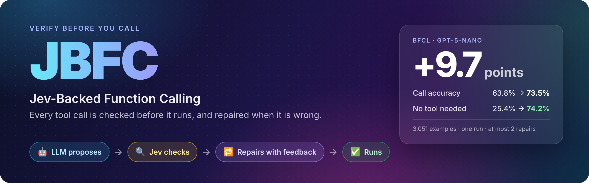
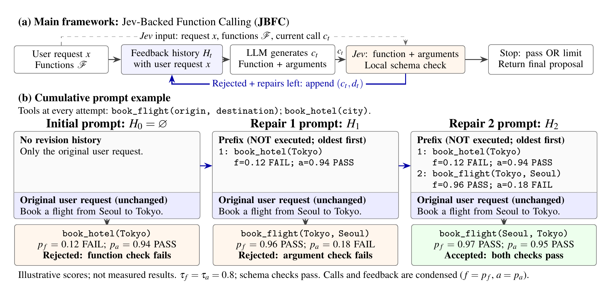

<p align="center">
  
</p>

<p align="center">
  
  
  
  
  
  
  
</p>

<p align="center">
  
  <a href="LICENSE"></a>
  
  
  <a href="paper/main.pdf"></a>
</p>

<p align="center">
  <a href="#how-it-works"><b>How it works</b></a> ·
  <a href="#see-it"><b>See it</b></a> ·
  <a href="#install"><b>Install</b></a> ·
  <a href="#quickstart"><b>Quickstart</b></a> ·
  <a href="#use-any-model"><b>Any model</b></a> ·
  <a href="#verify-calls-from-any-framework"><b>Verify</b></a> ·
  <a href="#results"><b>Results</b></a> ·
  <a href="#faq"><b>FAQ</b></a> ·
  <a href="#reproduce-the-paper"><b>Reproduce</b></a>
</p>

LLMs call the wrong function, invent argument values, and call tools when no tool applies. A JSON schema cannot catch that, because a wrong call can be perfectly well formed. **JBFC** puts a verifier between the model and your code. [Jev](https://typesafe.ai) answers two yes/no questions about every proposed call: *is this the right function?* and *are these the right arguments?* When a check fails, the same model gets the verdicts back and repairs the call. Only a call that passes runs.

```python
import jbfc

agent = jbfc.JBFC("openai:gpt-5-nano", tools=[get_weather, book_table])
agent.run("Is it jacket weather in Seoul tonight?")  # runs the call only if Jev accepts it
```

> [!TIP]
> Already have an agent? Keep it. `jbfc.verify(messages, tool_calls, tools)` checks calls from the OpenAI, Anthropic or Google SDKs before you execute them. [Jump there](#verify-calls-from-any-framework).

## How it works



**(a)** The LLM proposes a call $c_t$, one function with its arguments, or no call. A local schema check and Jev judge it: Jev sees the request, the available functions and the call, and answers *right function?* and, when there is a call, *right arguments?* as probabilities of yes. A check passes at 0.8 or more. A rejected call and its verdicts $d_t$ are appended to the feedback history $H_t$, and the model tries again. **(b)** The history goes *before* the original request, oldest first, and is marked as not executed, so the model sees every earlier attempt and can change the function, the arguments, or decide not to call. (The scores in (b) are illustrative.)

Each record is a labeled example: a call the model wrote, with Jev's verdict on it. Like the demonstrations in [many-shot in-context learning](https://arxiv.org/abs/2404.11018), more of them seemed to help in our run: the full history scored slightly above the latest record alone, and accuracy rose with the repair limit (which also adds attempts). Jev makes those labels in a fraction of a second, without reference answers.

The loop stops at the first proposal that passes every check, or after `max_repairs` repairs (3 by default). Nothing runs during repairs; `run()` executes only the final, accepted call.

## See it

Two real traces from the paper's run (`gpt-5-nano` on BFCL, `jev-1.13.0`). Red lines were rejected; green lines passed.

**An unnecessary call, withdrawn.** The only tool is unrelated, and the model calls it anyway:

```diff
  User:  How many kilograms are in a pound?
  Tools: portfolio_returns(initial_investment, ending_value, period)

- gpt-5-nano   portfolio_returns(ending_value=1, initial_investment=1)
- Jev          right function? p=0.04                              → rejected
+ gpt-5-nano   (no call) "A pound is exactly 0.45359237 kilograms."
+ Jev          right to make no call? p=0.97                       → accepted
```

**An invented argument, removed.** The user asked for a patio; the model added three amenities nobody asked for:

```diff
  User:  Find the closest sushi restaurant with a patio in Boston.

- gpt-5-nano   restaurant_search_find_closest(cuisine="Sushi", location="Boston",
-                  amenities=["Patio", "Wi-Fi", "Happy Hour", "Wheelchair Accessible"])
- Jev          right function? p=0.95   right arguments? p=0.17   → rejected
+ gpt-5-nano   restaurant_search_find_closest(cuisine="Sushi", location="Boston", amenities=["Patio"])
+ Jev          right function? p=0.97   right arguments? p=0.89   → accepted
```

## Why JBFC

<table>
  <tr>
    <td width="33%" valign="top"><b>🎯 Checks what schemas cannot</b><br>Wrong function, invented values, a call that should not happen at all. Jev judges meaning; a local schema check covers format.</td>
    <td width="33%" valign="top"><b>🔁 Repairs instead of failing</b><br>Rejected calls go back to the model with every earlier attempt and verdict. Nothing runs until a call passes.</td>
    <td width="33%" valign="top"><b>⚡ Light checks</b><br>A Jev verdict took about 0.3 s per call in our runs, less time than the model took to propose the call, and about $0.06 per 1,000 checks.</td>
  </tr>
  <tr>
    <td valign="top"><b>🔌 Any model</b><br>OpenAI, Anthropic, Gemini, xAI Grok, Azure OpenAI, OpenRouter, or any OpenAI-compatible server. Plain HTTP, no vendor SDKs.</td>
    <td valign="top"><b>🧰 Plain Python tools</b><br>Pass functions. Schemas come from type hints and docstrings; JSON Schema works too.</td>
    <td valign="top"><b>📄 Open study</b><br>The library runs the same loop as the paper. Code, the pinned BFCL revision and the checks behind every table are in this repo.</td>
  </tr>
</table>

## Install

Python 3.11 or newer. From a clone of this repository:

```bash
pip install -e .        # or: uv sync
```

Set the keys for Jev and for your model provider:

```bash
export TYPESAFE_API_KEY=...   # Jev, from TypeSafe (https://console.typesafe.ai)
export OPENAI_API_KEY=...     # or ANTHROPIC_API_KEY, GEMINI_API_KEY, XAI_API_KEY, ...
```

## Quickstart

```python
import jbfc

def get_weather(city: str, unit: str = "celsius") -> dict:
    """Current weather for a city.

    Args:
        city: City name, e.g. "Seoul".
        unit: "celsius" or "fahrenheit".
    """
    return {"city": city, "temp": 12, "unit": unit}

agent = jbfc.JBFC("openai:gpt-5-nano", tools=[get_weather])

result = agent.run("Do I need a jacket in Seoul tonight?")
result.call       # {"name": "get_weather", "arguments": {"city": "Seoul"}}
result.accepted   # True: Jev and the schema check passed
result.output     # {"city": "Seoul", "temp": 12, "unit": "celsius"}
result.repairs    # repairs it took (0 to 3)
```

`run()` executes the final call only if it passed. `call()` does everything except execute, so you decide:

```python
result = agent.call("Book a table for two at 7pm")
if result.accepted:
    ...                                  # run result.call yourself
elif result.no_call:
    print(result.text)                   # the model answered without a tool
```

## Use any model

The model is a `"provider:model"` string or a provider object. Options such as `api_key=` go to the provider; `jev_api_key=` goes to Jev.

```python
jbfc.JBFC("openai:gpt-5-nano")                       # OPENAI_API_KEY
jbfc.JBFC("anthropic:claude-sonnet-4-5")             # ANTHROPIC_API_KEY
jbfc.JBFC("gemini:gemini-2.5-flash")                 # GEMINI_API_KEY or GOOGLE_API_KEY
jbfc.JBFC("xai:grok-4")                              # XAI_API_KEY
jbfc.JBFC("openrouter:meta-llama/llama-3.3-70b-instruct")   # OPENROUTER_API_KEY
jbfc.JBFC("azure:my-deployment", endpoint="https://my-resource.openai.azure.com")  # AZURE_OPENAI_API_KEY

# Local or self-hosted, OpenAI-compatible (Ollama, vLLM, LM Studio, ...)
jbfc.JBFC(jbfc.OpenAICompatible("llama3.1", base_url="http://localhost:11434/v1"))

# Keys in code instead of the environment
jbfc.JBFC("anthropic:claude-sonnet-4-5", api_key="sk-ant-...", jev_api_key="...")
```

| Provider | Spec | Key | Class |
|---|---|---|---|
| OpenAI | `openai:<model>` | `OPENAI_API_KEY` | `jbfc.OpenAI` |
| Anthropic | `anthropic:<model>` | `ANTHROPIC_API_KEY` | `jbfc.Anthropic` |
| Google Gemini | `gemini:<model>` | `GEMINI_API_KEY` / `GOOGLE_API_KEY` | `jbfc.Gemini` |
| xAI Grok | `xai:<model>` | `XAI_API_KEY` | `jbfc.XAI` |
| Azure OpenAI | `azure:<deployment>` | `AZURE_OPENAI_API_KEY` + `AZURE_OPENAI_ENDPOINT` | `jbfc.AzureOpenAI` |
| OpenRouter | `openrouter:<model>` | `OPENROUTER_API_KEY` | `jbfc.OpenRouter` |
| Anything OpenAI-compatible | | optional | `jbfc.OpenAICompatible` |
| Jev (verifier) | | `TYPESAFE_API_KEY` | `jbfc.Jev` |

<details>
<summary><b>Provider options</b></summary>

Provider objects take `max_output_tokens` (4,096 by default), `temperature`, `system_prompt`, `timeout`, `max_retries` and `headers`; OpenAI-style providers also take `reasoning_effort`, and Gemini takes `thinking_budget`. A truncated, filtered or refused response is treated as a failed proposal and repaired, never as "no call". Any object with `generate(example, history)` returning `{"calls": ..., "content": ...}` can stand in for a provider.

</details>

## Tools

Plain functions work as they are: parameter types come from type hints (`str`, `int`, `float`, `bool`, `list[...]`, `dict[...]`, `Literal`, `Enum`, `Optional`, `TypedDict`, `Annotated[..., "description"]`), descriptions from Google, NumPy or Sphinx docstrings, and defaults from the signature. Use the decorator to override anything, or pass JSON Schema definitions in OpenAI, Anthropic or Gemini format:

```python
@jbfc.tool(name="weather", description="Current weather for a city.")
def get_weather(city: str, unit: Literal["celsius", "fahrenheit"] = "celsius") -> dict: ...

schema = {"type": "function", "function": {
    "name": "search", "description": "Search the web.",
    "parameters": {"type": "object", "properties": {"query": {"type": "string"}}, "required": ["query"]}}}
agent = jbfc.JBFC("openai:gpt-5-nano", tools=[get_weather, schema], functions={"search": my_search})
```

`jbfc.schema_of(fn)` shows the schema JBFC sends.

## Verify calls from any framework

Keep your agent and check its calls before you execute them. `verify` takes the conversation so far (earlier tool calls and tool results included) and the proposed calls, as plain dicts or as the message and tool-call objects of the OpenAI, Anthropic and Google SDKs.

```python
from openai import OpenAI

response = OpenAI().chat.completions.create(model="gpt-5-nano", messages=messages, tools=tools)
verdict = jbfc.verify(messages, response.choices[0].message.tool_calls, tools)

if verdict:                       # passed the schema check and both Jev checks
    execute(response.choices[0].message.tool_calls)
else:
    print(verdict.function_probability, verdict.arguments_probability, verdict.schema_errors)
    # verdict.feedback is the record JBFC would send back to the model for a repair
```

## Options and baselines

```python
jbfc.JBFC(
    "openai:gpt-5-nano",
    tools=[...],
    max_repairs=3,             # repairs after the first proposal
    threshold=0.8,             # Jev threshold for both checks
    method="jbfc",             # or a baseline: "direct", "schema", "self-refine",
                               # "jev-function", "jev-arguments", "jbfc-latest"
    execute_unverified=False,  # run() also executes a call still rejected at the limit
)
```

- `jbfc.Jev(api_key, threshold=0.8, function_threshold=None, arguments_threshold=None, model="jev-1.13.0")` configures the verifier; pass it as `jev=`.
- `acall`, `arun` and `averify` run the same steps in a worker thread for async code.
- `jbfc.SYSTEM_PROMPT` is the generator prompt used in the paper; replace it with `system_prompt=` on a provider.

<details>
<summary><b>The result object</b></summary>

| Field | Meaning |
|---|---|
| `calls` | final proposal: `[{"name", "arguments"}]`, `[]` for no call, `None` if unreadable |
| `call` | the first call, or `None` |
| `accepted` | passed every check (`None` for methods without a verifier) |
| `exhausted` | hit the repair limit without passing |
| `repairs` | repairs used |
| `text` | the model's text, e.g. its answer when it made no call |
| `executed`, `output` | whether `run()` executed the call, and what it returned |
| `attempts` | every proposal with its Jev probabilities and schema errors |
| `usage`, `latency_s` | tokens for the model and for Jev, and wall time |
| `trace` | the full record: proposals, verdicts and feedback |

</details>

## Results

> [!NOTE]
> A small study, not a benchmark claim: JBFC ran with one generator (`gpt-5-nano`, reasoning effort `none`) and one verifier (`jev-1.13.0`) on 3,051 single-turn examples from seven BFCL categories, once per method, with nothing tuned. Every `gpt-5-nano` method shares each example's first proposal. A larger model, `gpt-5.4-mini`, ran without Jev (Direct) under the same settings for reference. Intervals and caveats are in the [paper](paper/main.pdf).

<picture>
  <source media="(prefers-color-scheme: dark)" srcset="docs/assets/chart-categories-dark.png">
  
</picture>

<picture>
  <source media="(prefers-color-scheme: dark)" srcset="docs/assets/chart-methods-dark.png">
  
</picture>

- With `gpt-5-nano`, every repair method scored above Direct in this run; JBFC by 9.7 points (paired bootstrap 95% CI 8.5–11.0).
- Most of that difference comes from requests where no tool applies (Irrelevance: 25.4% → 74.2%). Where a call is needed, the gains are small (Simple Python +0.7, Multiple +0.5): a yes/no verdict says *that* a call is wrong, not *which* call is right.
- A larger model alone did better. Direct with `gpt-5.4-mini` reached 81.3%, 7.8 points above JBFC with `gpt-5-nano` (95% CI 6.4–9.3), mostly by calling unrelated tools less often, and in less time, at about three times JBFC's cost ($0.71 instead of $0.22 per 1,000 requests). JBFC closed 9.7 of the 17.5 points between the two models at 31% of the larger model's cost.
- Generic self-review spends three proposals on every request and trailed every Jev-based method, which averaged 1.5 to 1.8 proposals.
- Keeping the whole history scored 0.7 points above showing only the latest rejection (95% CI 0.1–1.4).
- Accepted is not the same as correct: calls that passed every check (68.4% of examples) were 90.6% correct.
- JBFC cost about four times Direct ($0.22 instead of $0.056 per 1,000 requests) and took 1.6 more API seconds.

<a id="more-repairs"></a>
<picture>
  <source media="(prefers-color-scheme: dark)" srcset="docs/assets/chart-limits-dark.png">
  
</picture>

Continuing the same run to higher repair limits raised call accuracy from 73.5% at two repairs to 78.6% at ten, at about three times the cost; most newly correct answers (178 of 194) were again cases where no tool applies. Even at ten repairs, at a cost similar to `gpt-5.4-mini`'s, JBFC stayed 2.7 points below it. The library default is now `max_repairs=3`, the limit after which each extra point costs about four times as much.

<details>
<summary><b>All numbers as tables</b></summary>

| Category | Examples | Direct, `gpt-5-nano` | JBFC, `gpt-5-nano` + Jev | Direct, `gpt-5.4-mini` |
|---|---:|---:|---:|---:|
| Simple Python | 400 | 90.8 | **91.5** | 90.8 |
| Multiple | 200 | 91.0 | 91.5 | **92.0** |
| Irrelevance | 240 | 25.4 | 74.2 | **87.1** |
| Live simple | 258 | 73.6 | 75.2 | **77.1** |
| Live multiple | 1,053 | 67.7 | 71.2 | **75.2** |
| Live irrelevance | 884 | 48.2 | 63.2 | **81.4** |
| **Total** (excl. 16 live relevance) | 3,035 | 63.8 | 73.5 | **81.3** |
| USD / 1k requests | | 0.056 | 0.221 | 0.706 |

| Method | Call acc. | Function acc. | Argument acc. | API sec. | USD / 1k requests |
|---|---:|---:|---:|---:|---:|
| Direct (no checks) | 63.8 | 74.8 | 81.2 | 1.30 | 0.056 |
| Schema repair | 65.7 | 76.4 | 81.8 | 1.36 | 0.059 |
| Self-refine (3 proposals, every request) | 69.8 | 80.0 | 82.3 | 4.01 | 0.190 |
| JBFC-F (function check only) | 72.6 | 83.5 | 81.8 | 2.61 | 0.190 |
| JBFC-A (argument check only) | 72.9 | 82.8 | **83.0** | 2.40 | 0.175 |
| JBFC-L (latest feedback only) | 72.8 | 83.1 | 82.6 | 2.92 | 0.217 |
| **JBFC** | **73.5** | **83.7** | 82.8 | 2.90 | 0.221 |

| `max_repairs` | 1 | 2 | 3 (default) | 5 | 7 | 10 |
|---|---:|---:|---:|---:|---:|---:|
| Call accuracy | 72.6 | 73.5 | 75.3 | 76.2 | 77.0 | 78.6 |
| Function accuracy | 83.0 | 83.7 | 85.0 | 86.0 | 86.5 | 87.7 |
| Mean repairs used | 0.42 | 0.75 | 1.07 | 1.69 | 2.29 | 3.17 |
| Reached the limit without passing | 33.4% | 31.8% | 30.9% | 30.2% | 29.7% | 29.2% |
| API seconds | 2.33 | 2.90 | 3.49 | 4.65 | 5.79 | 7.35 |
| USD / 1k requests | 0.172 | 0.221 | 0.273 | 0.378 | 0.483 | 0.669 |

</details>

## FAQ

**Is Jev just another LLM-as-a-judge?**
Jev is TypeSafe's decision model. It does not write explanations: it answers each yes/no question with a probability, in 0.30 s on average in the paper's run. JBFC asks two fixed questions (right function, right arguments) and also runs a local schema check.

**What does it cost?**
Each Jev check reads about 1,400 tokens, roughly $0.06 per 1,000 checks at $0.042 per million input tokens. With `gpt-5-nano`, JBFC cost $0.22 per 1,000 requests on average, against $0.056 for a bare call; a bare call to `gpt-5.4-mini` cost $0.71 and was more accurate.

**Does anything run while JBFC repairs a call?**
No. Proposals are marked as not executed, and `run()` executes only the final call after it passes (or, with `execute_unverified=True`, the last one).

**Can I use it with LangChain, the OpenAI Agents SDK, or my own loop?**
Yes. Call `jbfc.verify(...)` on the tool calls your framework produces, or let `JBFC.call()` make the decision for one step of your loop.

**Parallel tool calls?**
Not yet. JBFC decides one step at a time: a single call or no call, the setting it was evaluated on.

**Which models have been benchmarked?**
JBFC itself only with `gpt-5-nano` (Azure OpenAI). For reference, `gpt-5.4-mini` ran without Jev and was more accurate than JBFC with `gpt-5-nano`, at about three times the cost; whether Jev also helps a stronger model is untested. The other adapters follow each provider's documented API and are covered by offline tests.

## Limits

- **One decision per step.** JBFC decides a single call or no call. `call()` and `run()` take text messages, so give earlier tool results back to the model as text; `verify()` also accepts tool-call and tool-result messages.
- **A verifier is a model too.** Jev can accept a wrong call or reject a right one; accepted calls were 90.6% correct in the paper's run, not 100%.
- **Cost and latency.** Each proposal costs one generator call and one Jev call; with at most three repairs, that is up to four of each.
- **Evidence so far.** JBFC with one model, mostly English requests, one run. A larger model without Jev (`gpt-5.4-mini`) was more accurate at about three times the cost.

## Reproduce the paper

The experiment code lives in [`src/jev_fc`](src/jev_fc) and the manuscript in [`paper/main.tex`](paper/main.tex). JBFC's loop in the library *is* `jev_fc.pipeline.run_example`, and offline tests check that the library sends the same prompts as the experiments.

```bash
make setup         # uv sync and a .env from .env.example
make prepare       # download and convert the pinned BFCL revision (3,051 examples)
make test          # offline tests and lint; no keys needed
make check-config  # show the configured routes, models and keys, without API calls
make table1        # Direct vs JBFC (6,102 records)
make table2        # all seven methods (21,357 records); also fills Table 1
make table3        # Figure 2: JBFC at repair limits 1, 2, 3, 5, 7, 10, extending the Table 2 run
make compare       # Direct with gpt-5.4-mini on all examples (no Jev)
make r3            # Tables 1-2 at r=3: raise the Table 2 run, add JBFC to gpt-5.4-mini, fill both
python scripts/analyze_results.py results/table2_gpt-5-nano_r2   # the numbers quoted in Results
```

The paper's runs used an Azure OpenAI deployment of `gpt-5-nano` behind an Azure API Management gateway. Jev went through the same gateway, except for repairs 8 to 10 in Figure 2, which call TypeSafe directly with `TYPESAFE_API_KEY` (same model; recorded in the run's manifest). See [`docs/apim-gateway.md`](docs/apim-gateway.md). With `WORKERS=8`, Table 2 took about two hours and $2.4 at list prices, extending it to ten repairs about 30 minutes and $1.4, and the `gpt-5.4-mini` Direct run (`make compare`) about 8 minutes and $2.2. Completed records are reused when a run resumes. Run notes and checks are in [`docs/validation.md`](docs/validation.md).

<details>
<summary><b>Repository layout</b></summary>

```text
src/jbfc/      the library: JBFC, providers, Jev, tools
src/jev_fc/    experiment code: repair loop, Jev client, BFCL data and scoring, CLI (jev-fc)
scripts/       table runs, run extension for Figure 2, analysis, paper build and checks
paper/         manuscript and PDF
tests/         offline tests
docs/          benchmark, gateway, literature and validation notes; README images
```

</details>

## Citation

```bibtex
@misc{yu2026jbfc,
  title  = {Jev-Backed Function Calling: Agentic In-Context Learning with Cumulative Decision Feedback},
  author = {Yu, Minhyeong},
  year   = {2026},
  note   = {Enhans}
}
```

## License

[MIT](LICENSE). BFCL data are not part of this repository: `make prepare` downloads them from the pinned BFCL revision, under BFCL's own license.

## Acknowledgements

This work was created as part of the No-More-Slops group activities at Pseudo Lab. Jev is TypeSafe's verifier model; the benchmark is the Berkeley Function Calling Leaderboard (BFCL).
