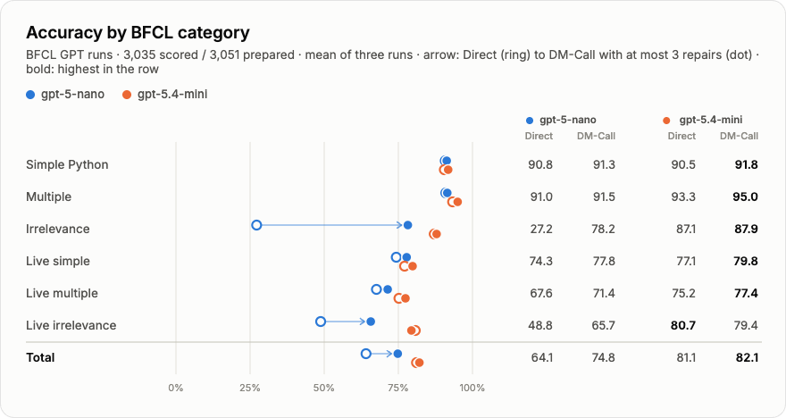
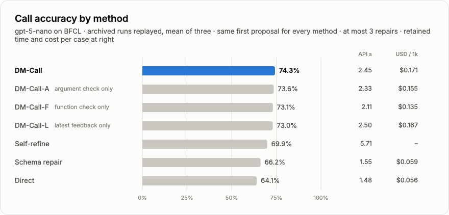
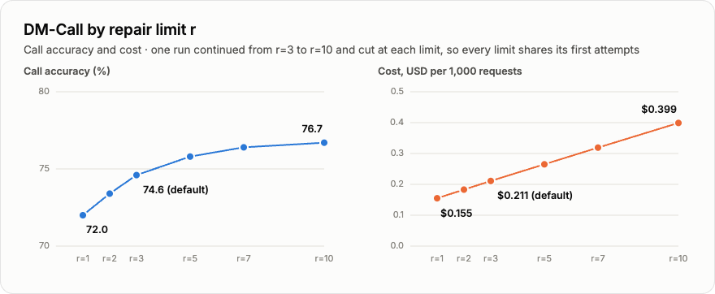

<p align="center">
  
</p>

<p align="center">
  
  
  
  
  
  
  
</p>

<p align="center">
  
  <a href="LICENSE"></a>
  
  
  <a href="paper/main.pdf"></a>
</p>

<p align="center">
  <a href="#how-it-works"><b>How it works</b></a> ·
  <a href="#see-it"><b>See it</b></a> ·
  <a href="#install"><b>Install</b></a> ·
  <a href="#quickstart"><b>Quickstart</b></a> ·
  <a href="#use-any-model"><b>Any model</b></a> ·
  <a href="#verify-calls-from-any-framework"><b>Verify</b></a> ·
  <a href="#results"><b>Results</b></a> ·
  <a href="#faq"><b>FAQ</b></a> ·
  <a href="#reproduce-the-paper"><b>Reproduce</b></a>
</p>

Current paper: **[paper/main.pdf](paper/main.pdf)**, an anonymous review copy updated on 2026-11-04. Its LaTeX source is kept outside this repository; the `.tex` files under `paper/` are the earlier manuscript ([Overleaf comment resolutions](docs/overleaf-comment-resolution-2026-10-20.md)). The method is called **DM-Call** (Decision-Model-Guided Function Calling); the manuscript title is **DM-Call: Decision-Model-Guided Function Calling with Cumulative Verification Feedback**. The public library uses `import dmcall` and `dmcall.DMCall(...)`. Earlier `dmgfc`, `dmfc` and `jbfc` imports remain compatibility aliases. Recorded experiment IDs and result directories keep their original names for reproducibility.

LLMs call the wrong function, invent argument values, and call tools when no tool applies. A JSON schema cannot catch that, because a wrong call can be perfectly well formed. **DM-Call** puts a verifier between the model and your code. [Jev](https://typesafe.ai) answers two yes/no questions about every proposed call: *is this the right function?* and *are these the right arguments?* When a check fails, the same model gets the verdicts back and repairs the call. Only a call that passes runs.

```python
import dmcall

agent = dmcall.DMCall("openai:gpt-5-nano", tools=[get_weather, book_table])
agent.run("Is it jacket weather in Seoul tonight?")  # runs the call only if Jev accepts it
```

> [!TIP]
> Already have an agent? Keep it. `dmcall.verify(messages, tool_calls, tools)` checks calls from the OpenAI, Anthropic or Google SDKs before you execute them. [Jump there](#verify-calls-from-any-framework).

## How it works


The figure is Figure 1 of the paper. Direct generation returns the model's first call, schema repair fixes only what a local schema check reports, and generic self-review asks the model to critique itself. In DM-Call the LLM proposes a call $c_t$, one function with its arguments, or no call. A local schema check and Jev judge it: Jev sees the request, the available functions and the call, and answers *right function?* and, when there is a call, *right arguments?* as probabilities of yes. A check passes at 0.5 or more. A rejected call and its verdicts $d_t$ are appended to the feedback history $H_t$, and the model tries again. The history goes *before* the original request, oldest first, and is marked as not executed, so the model sees every earlier attempt and can change the function, the arguments, or decide not to call. Each probability in the history also carries a label from five equal bands, from *very likely incorrect* to *very likely correct* (Hybrid feedback, as in the paper; `feedback="numeric"` sends the probabilities alone). A readable first answer of no call is returned as is, without a check (`preserve_initial_no_call=False` checks it too); a no call proposed during a repair is still checked.

Each history record contains a candidate and the verifier's actual judgments, without reference answers. The [many-shot in-context learning](https://arxiv.org/abs/2404.11018) literature motivates studying how prior examples affect later proposals. DM-Call uses rejected candidates as feedback; its cumulative-history ablation and repair-limit analysis appear in [Results](#results).

The loop stops at the first proposal that passes every check, or after `max_repairs` repairs (3 by default). If none passes, the result is the model's first proposal, so a repair replaces the model's answer only once Jev accepts it (`on_exhaustion="last"` returns the last repair instead). Nothing runs during repairs; `run()` executes only an accepted call.

## See it

Two real traces from an earlier `gpt-5-nano` BFCL run (`jev-1.13.0`, threshold 0.5). Red lines were rejected; green lines passed.

**An unnecessary call, withdrawn.** The only tool is unrelated, and the model calls it anyway:

```diff
  User:  How many kilograms are in a pound?
  Tools: portfolio_returns(initial_investment, ending_value, period)

- gpt-5-nano   portfolio_returns(ending_value=1, initial_investment=1)
- Jev          right function? p=0.03                              → rejected
+ gpt-5-nano   (no call) "A pound (lb) is defined as 0.45359237 kilograms (exact in the modern definition)."
+ Jev          right to make no call? p=0.97                       → accepted
```

**An invented argument, removed.** The user asked for a patio; the model added three amenities nobody asked for, and repeated the call once before removing them:

```diff
  User:  Find the closest sushi restaurant with a patio in Boston.

- gpt-5-nano   restaurant_search_find_closest(cuisine="Sushi", location="Boston",
-                  amenities=["Patio", "Wi-Fi", "Happy Hour", "Wheelchair Accessible"])
- Jev          right function? p=0.95   right arguments? p=0.16   → rejected (twice)
+ gpt-5-nano   restaurant_search_find_closest(cuisine="Sushi", location="Boston", amenities=["Patio"])
+ Jev          right function? p=0.97   right arguments? p=0.89   → accepted
```

## Why DM-Call

<table>
  <tr>
    <td width="33%" valign="top"><b>🎯 Checks what schemas cannot</b><br>Wrong function, invented values, a call that should not happen at all. Jev judges meaning; a local schema check covers format.</td>
    <td width="33%" valign="top"><b>🔁 Repairs instead of failing</b><br>Rejected calls go back to the model with every earlier attempt and verdict. Nothing runs until a call passes.</td>
    <td width="33%" valign="top"><b>🔍 Decision-model feedback</b><br>The default verifier is Jev; the open-weight PPLX Decider also works. Both return binary judgment probabilities without generating explanations or requiring reference answers.</td>
  </tr>
  <tr>
    <td valign="top"><b>🔌 Any model</b><br>OpenAI, Anthropic, Gemini, xAI Grok, Azure OpenAI, OpenRouter, or any OpenAI-compatible server. Plain HTTP, no vendor SDKs.</td>
    <td valign="top"><b>🧰 Plain Python tools</b><br>Pass functions. Schemas come from type hints and docstrings; JSON Schema works too.</td>
    <td valign="top"><b>📄 Open study</b><br><code>dmcall.DMCall</code> runs the paper's loop with its settings: Hybrid feedback and the first no-call kept. The library, the pinned BFCL revision and the scoring checks are in this repo.</td>
  </tr>
</table>

## Install

Python 3.11 or newer. Clone the repository using your personal GitHub SSH configuration:

```bash
git clone git@github.com-personal:gogoymh/decision-model-guided-function-calling.git
cd decision-model-guided-function-calling
pip install -e .        # or: uv sync
```

The distribution is named `dmcall`; its public API is `import dmcall` and `dmcall.DMCall(...)`. Earlier `dmgfc.DMGFC(...)`, `dmfc.DMFC(...)` and `jbfc.JBFC(...)` applications and their method names remain supported and run the same code. See the [migration guide](docs/dmgfc-public-api-migration-2026-10-24.md) for the exact names.

Set the keys for Jev and for your model provider:

```bash
export TYPESAFE_API_KEY=...   # Jev, from TypeSafe (https://console.typesafe.ai)
export OPENAI_API_KEY=...     # or ANTHROPIC_API_KEY, GEMINI_API_KEY, XAI_API_KEY, ...
```

## Quickstart

```python
import dmcall

def get_weather(city: str, unit: str = "celsius") -> dict:
    """Current weather for a city.

    Args:
        city: City name, e.g. "Seoul".
        unit: "celsius" or "fahrenheit".
    """
    return {"city": city, "temp": 12, "unit": unit}

agent = dmcall.DMCall("openai:gpt-5-nano", tools=[get_weather])

result = agent.run("Do I need a jacket in Seoul tonight?")
result.call       # {"name": "get_weather", "arguments": {"city": "Seoul"}}
result.accepted   # True: Jev and the schema check passed
result.output     # {"city": "Seoul", "temp": 12, "unit": "celsius"}
result.repairs    # repairs it took (0 to 3)
```

`run()` executes the final call only if it passed. `call()` does everything except execute, so you decide:

```python
result = agent.call("Book a table for two at 7pm")
if result.accepted:
    ...                                  # run result.call yourself
elif result.no_call:
    print(result.text)                   # the model answered without a tool
```

## Use any model

The model is a `"provider:model"` string or a provider object. Options such as `api_key=` go to the provider; `jev_api_key=` goes to Jev.

```python
dmcall.DMCall("openai:gpt-5-nano")                       # OPENAI_API_KEY
dmcall.DMCall("anthropic:claude-sonnet-4-5")             # ANTHROPIC_API_KEY
dmcall.DMCall("gemini:gemini-2.5-flash")                 # GEMINI_API_KEY or GOOGLE_API_KEY
dmcall.DMCall("xai:grok-4")                              # XAI_API_KEY
dmcall.DMCall("openrouter:meta-llama/llama-3.3-70b-instruct")   # OPENROUTER_API_KEY
dmcall.DMCall("azure:my-deployment", endpoint="https://my-resource.openai.azure.com")  # AZURE_OPENAI_API_KEY

# Local or self-hosted, OpenAI-compatible (Ollama, vLLM, LM Studio, ...)
dmcall.DMCall(dmcall.OpenAICompatible("llama3.1", base_url="http://localhost:11434/v1"))

# Keys in code instead of the environment
dmcall.DMCall("anthropic:claude-sonnet-4-5", api_key="sk-ant-...", jev_api_key="...")
```

| Provider | Spec | Key | Class |
|---|---|---|---|
| OpenAI | `openai:<model>` | `OPENAI_API_KEY` | `dmcall.OpenAI` |
| Anthropic | `anthropic:<model>` | `ANTHROPIC_API_KEY` | `dmcall.Anthropic` |
| Google Gemini | `gemini:<model>` | `GEMINI_API_KEY` / `GOOGLE_API_KEY` | `dmcall.Gemini` |
| xAI Grok | `xai:<model>` | `XAI_API_KEY` | `dmcall.XAI` |
| Azure OpenAI | `azure:<deployment>` | `AZURE_OPENAI_API_KEY` + `AZURE_OPENAI_ENDPOINT` | `dmcall.AzureOpenAI` |
| OpenRouter | `openrouter:<model>` | `OPENROUTER_API_KEY` | `dmcall.OpenRouter` |
| Anything OpenAI-compatible | | optional | `dmcall.OpenAICompatible` |
| Jev (verifier) | | `TYPESAFE_API_KEY` | `dmcall.Jev` |

<details>
<summary><b>Provider options</b></summary>

Provider objects take `max_output_tokens` (4,096 by default), `temperature`, `system_prompt`, `timeout`, `max_retries` and `headers`; OpenAI-style providers also take `reasoning_effort`, and Gemini takes `thinking_budget`. A truncated, filtered or refused response is treated as a failed proposal and repaired, never as "no call". Any object with `generate(example, history)` returning `{"calls": ..., "content": ...}` can stand in for a provider.

</details>

## Tools

Plain functions work as they are: parameter types come from type hints (`str`, `int`, `float`, `bool`, `list[...]`, `dict[...]`, `Literal`, `Enum`, `Optional`, `TypedDict`, `Annotated[..., "description"]`), descriptions from Google, NumPy or Sphinx docstrings, and defaults from the signature. Use the decorator to override anything, or pass JSON Schema definitions in OpenAI, Anthropic or Gemini format:

```python
@dmcall.tool(name="weather", description="Current weather for a city.")
def get_weather(city: str, unit: Literal["celsius", "fahrenheit"] = "celsius") -> dict: ...

schema = {"type": "function", "function": {
    "name": "search", "description": "Search the web.",
    "parameters": {"type": "object", "properties": {"query": {"type": "string"}}, "required": ["query"]}}}
agent = dmcall.DMCall("openai:gpt-5-nano", tools=[get_weather, schema], functions={"search": my_search})
```

`dmcall.schema_of(fn)` shows the schema DM-Call sends.

## Verify calls from any framework

Keep your agent and check its calls before you execute them. `verify` takes the conversation so far (earlier tool calls and tool results included) and the proposed calls, as plain dicts or as the message and tool-call objects of the OpenAI, Anthropic and Google SDKs.

```python
from openai import OpenAI

response = OpenAI().chat.completions.create(model="gpt-5-nano", messages=messages, tools=tools)
verdict = dmcall.verify(messages, response.choices[0].message.tool_calls, tools)

if verdict:                       # passed the schema check and both Jev checks
    execute(response.choices[0].message.tool_calls)
else:
    print(verdict.function_probability, verdict.arguments_probability, verdict.schema_errors)
    # verdict.feedback is the record DM-Call would send back to the model for a repair
```

## Options and baselines

```python
dmcall.DMCall(
    "openai:gpt-5-nano",
    tools=[...],
    max_repairs=3,             # repairs after the first proposal
    threshold=0.5,             # Jev threshold for both checks
    on_exhaustion="first",     # if nothing passes: return the first proposal ("last": the last repair)
    method="dmcall",            # or a baseline: "direct", "schema", "self-refine",
                               # "dmcall-f", "dmcall-a", "dmcall-latest"
    execute_unverified=False,  # True also permits the final unverified proposal to run
    feedback="hybrid",         # probabilities with labels in repair feedback ("numeric": probabilities only)
    preserve_initial_no_call=True,  # return a readable first no-call without a check
)
```

| Paper label | Public method option | Recorded experiment ID |
|---|---|---|
| Direct | `direct` | `direct` |
| Schema repair | `schema` | `schema_only` |
| Self-refine | `self-refine` | `self_refine` |
| DM-Call-F: function judgment only | `dmcall-f` | `jev_function` |
| DM-Call-A: argument judgment only | `dmcall-a` | `jev_arguments` |
| DM-Call-L: latest rejected candidate only | `dmcall-latest` | `jev_joint_latest` |
| DM-Call: both judgments, cumulative history | `dmcall` | `jev_joint` |

- The defaults are the paper's settings: at most three repairs, threshold 0.5, the first proposal when nothing passes, Hybrid feedback, and a readable first no-call returned without a check. `call()` and `run()` also take `max_repairs=` and `on_exhaustion=` per request.
- The paper's other baselines, MAD-FC and PF-FC, run in its experiment runner and are not methods of this library.
- `dmcall.Jev(api_key, threshold=0.5, function_threshold=None, arguments_threshold=None, model="jev-1.13.0")` configures the verifier; pass it as `jev=`.
- `acall`, `arun` and `averify` run the same steps in a worker thread for async code.
- `dmcall.SYSTEM_PROMPT` is the generator prompt used in the paper; replace it with `system_prompt=` on a provider.

<details>
<summary><b>The result object</b></summary>

| Field | Meaning |
|---|---|
| `calls` | final proposal: `[{"name", "arguments"}]`, `[]` for no call, `None` if unreadable; the first proposal when nothing passed (`on_exhaustion="first"`) |
| `call` | the first call, or `None` |
| `accepted` | passed every check (`None` for methods without a verifier, and for a first no-call returned without a check) |
| `initial_no_call_preserved` | the first proposal was a readable no-call, returned without a check |
| `exhausted` | hit the repair limit without passing |
| `repairs` | repairs used |
| `final_attempt` | which proposal in `trace` is final (0: the first) |
| `text` | the model's text, e.g. its answer when it made no call |
| `executed`, `output` | whether `run()` executed the call, and what it returned |
| `attempts` | every proposal with its Jev probabilities and schema errors |
| `usage`, `latency_s` | tokens for the model and for Jev, and wall time |
| `trace` | the full record: proposals, verdicts and feedback |

</details>

## Native decision model on DGX Spark

For new experiments, `dmcall.PerplexityDecider` connects to the native
[Perplexity Decider v1.1 27B](https://huggingface.co/perplexity-ai/pplx-decider-v1.1-27b)
checkpoint at an immutable revision. Pass it explicitly as `jev=` to
`dmcall.DMCall`. Jev remains the default verifier.
The [DGX experiment guide](docs/dgx-decider-experiments.md) covers the isolated
runtime, input and model fingerprints, bounded smoke tests, and the separate
experiment runner. The paper's DM-Call (PPLX) results use this checkpoint, run
locally in BF16 with its calibration temperature (1.009).

## Results

> [!NOTE]
> These are the paper's current results. Four generators (`gpt-5-nano`, `gpt-5.4-mini` and `claude-sonnet-5-5` through their APIs, and the open-weight `gemma-4-31b-it` served locally with vLLM) and two decision models (the hosted `jev-1.13.0` and the open-weight PPLX Decider v1.1, run locally) were evaluated on 3,035 BFCL single-turn cases and on an exploratory 156-case API-Bank first-call adaptation. Every method has three runs. DM-Call uses at most three repairs, threshold 0.5, Hybrid feedback and the first proposal when none passes, and it returns a readable first no-call unchanged. These settings were chosen on the same benchmarks without a held-out split, and no function is executed. MAD-FC (three agents debate one round and take a majority vote) and PF-FC (`gpt-5.4-mini` reviews each Direct call and refines it up to three times) are the paper's external baselines; they run in its experiment runner, not in this library.

BFCL accuracy (%), mean of three runs:

| Generator | Direct | MAD-FC | PF-FC | DM-Call (Jev) | DM-Call (PPLX) |
|---|---:|---:|---:|---:|---:|
| `gpt-5-nano` | 64.12 | 60.20 | 74.54 | 74.63 | 74.24 |
| `gpt-5.4-mini` | 81.59 | 79.09 | 81.79 | 82.54 | 82.20 |
| `claude-sonnet-5-5` | 88.25 | 82.38 | 86.45 | 88.56 | 88.46 |
| `gemma-4-31b-it` | 86.67 | 39.29 | 84.85 | 86.91 | 86.88 |

API-Bank (adapted, exploratory) accuracy (%), mean of three runs:

| Generator | Direct | MAD-FC | PF-FC | DM-Call (Jev) | DM-Call (PPLX) |
|---|---:|---:|---:|---:|---:|
| `gpt-5-nano` | 61.32 | 29.27 | 70.09 | 64.32 | 64.53 |
| `gpt-5.4-mini` | 80.13 | 80.98 | 76.71 | 80.13 | 80.13 |
| `claude-sonnet-5-5` | 86.97 | 73.93 | 83.12 | 87.39 | 87.39 |
| `gemma-4-31b-it` | 81.41 | 0.85 | 77.56 | 81.62 | 81.41 |

USD per 1,000 BFCL cases at quoted API prices. Models run locally (`gemma-4-31b-it` and the PPLX Decider) are not priced:

| Generator | Direct | MAD-FC | PF-FC | DM-Call (Jev) |
|---|---:|---:|---:|---:|
| `gpt-5-nano` | 0.055 | 0.502 | 1.945 | 0.173 |
| `gpt-5.4-mini` | 0.707 | 5.438 | 2.224 | 0.917 |
| `claude-sonnet-5-5` | 4.151 | 31.307 | 6.157 | 4.609 |

- On BFCL, DM-Call with Jev scored above Direct with all four generators: by 10.5 points with `gpt-5-nano` (paired bootstrap 95% CI 9.5 to 11.5), 0.9 with `gpt-5.4-mini` (0.6 to 1.3), 0.3 with `claude-sonnet-5-5` (0.1 to 0.5) and 0.2 with `gemma-4-31b-it` (0.0 to 0.5). With the PPLX Decider it stayed within 0.4 points of Jev.
- DM-Call rarely turned a correct Direct answer into a wrong one. Per run it fixed 319 to 322 `gpt-5-nano` cases and broke 0 to 2; with the other generators it fixed 11 to 37 and broke 3 to 6. A readable first no-call is returned without a check, which covered 18% of `gpt-5-nano`'s BFCL cases and about a third of the other generators'.
- API-Bank gains were smaller: 3.0 points with `gpt-5-nano` (1.5 to 4.9), none with `gpt-5.4-mini`, and 0.4 and 0.2 points with `claude-sonnet-5-5` and `gemma-4-31b-it`, whose intervals include zero. PF-FC scored highest on API-Bank with `gpt-5-nano` and MAD-FC with `gpt-5.4-mini`.
- MAD-FC scored below Direct on BFCL with every generator, and PF-FC scored below Direct with `claude-sonnet-5-5` and `gemma-4-31b-it`. Part of their loss comes from outputs scored as wrong: `claude-sonnet-5-5` refused 5% (BFCL) and 15% (API-Bank) of MAD-FC's peer-wave requests, `gemma-4-31b-it` wrote 92% of its MAD-FC peer-wave calls as text instead of native calls, and PF-FC's reviewer returned an unreadable review for 2% to 5% of cases.
- With Jev, DM-Call cost 3.2 times Direct with `gpt-5-nano`, 1.3 times with `gpt-5.4-mini` and 1.1 times with `claude-sonnet-5-5`. Each extra correct BFCL call over Direct cost $0.0011 with `gpt-5-nano` and $0.022 with `gpt-5.4-mini`. PF-FC cost 1.3 to 11 times as much as DM-Call, and MAD-FC 3 to 7 times.
- A larger model alone still beat the small model with DM-Call: Direct with `gpt-5.4-mini` scored 7.0 points above DM-Call with `gpt-5-nano` on BFCL (95% CI 5.6 to 8.2), at 4.1 times the cost.
- Accepted is not the same as correct: with `gpt-5-nano`, the final call passed every check in 70% of BFCL cases, and 83% of those were correct (81% to 85% with the other generators).
- With `gpt-5-nano`, DM-Call's requests took 4.03 s per BFCL case in total, against 2.56 s for Direct. The three runs agree: DM-Call's BFCL totals vary by a standard deviation of 0.05 to 0.51 points.

### BFCL categories

<picture>
  <source media="(prefers-color-scheme: dark)" srcset="docs/assets/chart-categories-dark.png">
  
</picture>

Most of `gpt-5-nano`'s gain came from requests where no tool applies (Irrelevance 23.2% to 79.0%, Live irrelevance 47.5% to 66.6%); the categories that need a call moved by 0.4 to 1.0 points. `claude-sonnet-5-5` and `gemma-4-31b-it` changed by at most 1.3 points in any category (table below).

### Ablations

<picture>
  <source media="(prefers-color-scheme: dark)" srcset="docs/assets/chart-methods-dark.png">
  
</picture>

The paper's Table 2 replays archived `gpt-5-nano` BFCL trajectories (three runs, Jev, at most three repairs) under the current rules; every method starts from the same first answers. Time and cost sum the retained requests, so they are references rather than fresh measurements, and Self-refine's retained cost is unknown.

- Schema repair and Self-refine gained 2.1 and 5.8 points over Direct; the decision-model variants gained 8.9 to 10.2.
- Both checks together gave the highest call accuracy, and argument-only feedback (DM-Call-A) the highest argument accuracy given the right function.
- Keeping the whole history scored 1.27 points above showing only the latest rejection (95% CI 0.87 to 1.69).
- Self-refine spends four proposals on every request: 5.71 retained API seconds per case, against 2.11 to 2.50 for the decision-model variants.
- In the paper's Table 3, Hybrid feedback was clearly better than probabilities alone only for `gpt-5-nano` on BFCL (+0.6 points) and never clearly worse, so it is the default.

<a id="more-repairs"></a>
### Repair limit

<picture>
  <source media="(prefers-color-scheme: dark)" srcset="docs/assets/chart-limits-dark.png">
  
</picture>

Continuing the three `gpt-5-nano` BFCL runs to ten repairs raised call accuracy from 74.63% at three repairs (the default) to 76.38%, while cost rose from $0.173 to $0.293 per 1,000 cases and the p95 of summed request time from 9.7 s to 24.3 s. Five repairs would add 0.9 points for 16% more requests and a 42% higher p95. The default sits at the knee of accuracy against requests; one of the three runs alone would favor five repairs.

<details>
<summary><b>Results as tables</b></summary>

BFCL categories, Direct → DM-Call with Jev, mean of three runs (%):

| Category | Cases | `gpt-5-nano` | `gpt-5.4-mini` | `claude-sonnet-5-5` | `gemma-4-31b-it` |
|---|---:|---:|---:|---:|---:|
| Simple Python | 400 | 91.6 → 92.0 | 90.9 → 91.3 | 95.8 → 95.6 | 95.1 → 94.8 |
| Multiple | 200 | 91.0 → 91.8 | 93.0 → 93.7 | 97.7 → 97.2 | 94.8 → 94.8 |
| Irrelevance | 240 | 23.2 → 79.0 | 88.6 → 90.7 | 90.4 → 91.7 | 91.5 → 91.5 |
| Live simple | 258 | 75.8 → 76.6 | 77.9 → 78.3 | 87.1 → 87.5 | 88.4 → 88.2 |
| Live multiple | 1,053 | 69.0 → 70.0 | 76.0 → 76.4 | 84.9 → 85.1 | 81.3 → 81.6 |
| Live irrelevance | 884 | 47.5 → 66.6 | 80.6 → 82.3 | 86.4 → 87.1 | 85.6 → 86.2 |
| Total (excl. 16 live relevance) | 3,035 | 64.1 → 74.6 | 81.6 → 82.5 | 88.2 → 88.6 | 86.7 → 86.9 |

Ablations, `gpt-5-nano` on BFCL, archived runs replayed, mean ± s.d. of three runs (the paper's Table 2; time and cost are retained references):

| Method | Call (%) | Function (%) | Arguments, given the right function (%) | API s | USD / 1k cases |
|---|---:|---:|---:|---:|---:|
| Direct | 64.11 ± 0.31 | 75.11 ± 0.29 | 81.27 ± 0.14 | 1.48 | 0.056 |
| Schema repair | 66.25 ± 0.42 | 76.96 ± 0.46 | 81.76 ± 0.20 | 1.55 | 0.059 |
| Self-refine | 69.94 ± 0.30 | 80.21 ± 0.42 | 82.07 ± 0.15 | 5.71 | unknown |
| DM-Call-F (function check only) | 73.12 ± 0.46 | 83.84 ± 0.52 | 81.78 ± 0.07 | 2.11 | 0.135 |
| DM-Call-A (argument check only) | 73.61 ± 0.33 | 83.73 ± 0.52 | 82.64 ± 0.38 | 2.33 | 0.155 |
| DM-Call-L (latest feedback only) | 73.05 ± 0.24 | 83.61 ± 0.22 | 82.05 ± 0.16 | 2.50 | 0.167 |
| DM-Call | 74.32 ± 0.22 | 84.80 ± 0.26 | 82.18 ± 0.13 | 2.45 | 0.171 |

Feedback representation at three repairs, mean ± s.d. of three runs (the paper's Table 3; `gemma-4-31b-it` reuses Table 1's first answers, the others archived ones):

| Benchmark | Generator | Numeric (%) | Text (%) | Hybrid (%) |
|---|---|---:|---:|---:|
| BFCL | `gpt-5-nano` | 73.72 ± 0.17 | 73.86 ± 0.18 | 74.32 ± 0.22 |
| BFCL | `gpt-5.4-mini` | 82.14 ± 0.10 | 82.20 ± 0.08 | 82.11 ± 0.11 |
| BFCL | `claude-sonnet-5-5` | 88.58 ± 0.30 | 88.61 ± 0.31 | 88.58 ± 0.28 |
| BFCL | `gemma-4-31b-it` | 86.93 ± 0.10 | 86.91 ± 0.11 | 86.91 ± 0.12 |
| API-Bank | `gpt-5-nano` | 61.97 ± 2.67 | 61.11 ± 2.06 | 61.54 ± 2.56 |
| API-Bank | `gpt-5.4-mini` | 78.63 ± 0.37 | 78.63 ± 0.37 | 78.63 ± 0.37 |
| API-Bank | `claude-sonnet-5-5` | 87.18 ± 0.00 | 87.18 ± 0.00 | 87.18 ± 0.00 |
| API-Bank | `gemma-4-31b-it` | 81.62 ± 0.37 | 81.62 ± 0.37 | 81.62 ± 0.37 |

Repair limit, `gpt-5-nano` on BFCL with Jev, mean of three runs (the paper's Figure 2; time sums request durations per case):

| `max_repairs` | 1 | 2 | 3 (default) | 5 | 7 | 10 |
|---|---:|---:|---:|---:|---:|---:|
| Call accuracy (%) | 71.84 | 73.61 | 74.63 | 75.57 | 75.99 | 76.38 |
| Function accuracy (%) | 82.34 | 83.93 | 84.93 | 85.84 | 86.24 | 86.61 |
| Mean repairs used | 0.24 | 0.39 | 0.51 | 0.74 | 0.95 | 1.25 |
| Reached the limit without passing | 15.0% | 12.9% | 11.7% | 10.6% | 10.1% | 9.5% |
| Request time, mean (s) | 3.43 | 3.75 | 4.03 | 4.53 | 5.00 | 5.68 |
| Request time, p95 (s) | 6.06 | 7.77 | 9.69 | 13.76 | 17.88 | 24.32 |
| USD / 1k cases | 0.133 | 0.154 | 0.173 | 0.208 | 0.242 | 0.293 |

Analyses of the earlier BFCL GPT runs (threshold selection, first-versus-last fallback) are in [docs/benchmarks.md](docs/benchmarks.md), [docs/threshold.md](docs/threshold.md) and [docs/repair-budget.md](docs/repair-budget.md).

</details>

## FAQ

**Is Jev just another LLM-as-a-judge?**
Jev is TypeSafe's decision model. It does not write explanations: it answers each yes/no question with a probability, in 0.16 to 0.21 s per check on average in the paper's BFCL runs. DM-Call asks two fixed questions (right function, right arguments) and also runs a local schema check.

**What does it cost?**
Each Jev check reads about 1,400 tokens with `gpt-5-nano` on BFCL, roughly $0.06 per 1,000 checks at $0.042 per million input tokens. With `gpt-5-nano`, DM-Call cost $0.173 per 1,000 BFCL cases on average, against $0.055 for a bare call; a bare call to `gpt-5.4-mini` cost $0.707 and was more accurate.

**Does anything run while DM-Call repairs a call?**
No. Proposals are marked as not executed, and `run()` executes only the final call after it passes (or, with `execute_unverified=True`, the final proposal even if none passed: the first one by default).

**Can I use it with LangChain, the OpenAI Agents SDK, or my own loop?**
Yes. Call `dmcall.verify(...)` on the tool calls your framework produces, or let `DMCall.call()` make the decision for one step of your loop.

**Parallel tool calls?**
Not yet. DM-Call decides one step at a time: a single call or no call, the setting it was evaluated on.

**Which models have been benchmarked?**
`gpt-5-nano`, `gpt-5.4-mini` and `claude-sonnet-5-5` through their APIs, and `gemma-4-31b-it` served locally with vLLM, each over three runs on BFCL and the exploratory API-Bank adaptation, with Jev and the PPLX Decider as decision models and MAD-FC and PF-FC as baselines. Effects vary by generator and benchmark; see [Results](#results). Other provider adapters are covered by offline tests, not these benchmark results.

**When does DM-Call help?**
The largest BFCL gain, 10.5 points, came from `gpt-5-nano` withdrawing unnecessary calls. The stronger generators gained 0.2 to 0.9 points on BFCL, and API-Bank gains were 0 to 3.0 points, several with intervals that include zero. Measure on your own traffic; `verify()` returns verdicts without revising the call.

## Limits

- **One decision per step.** DM-Call decides a single call or no call. `call()` and `run()` take text messages, so give earlier tool results back to the model as text; `verify()` also accepts tool-call and tool-result messages.
- **A verifier is a model too.** A decision model can accept a wrong call or reject a right one: with `gpt-5-nano` on BFCL, 83% of the final calls that passed every check were correct (81% to 85% with the other generators).
- **Cost and latency.** Each proposal costs one generator call and one decision-model call; with at most three repairs, that is up to four of each.
- **Evidence so far.** Four generators (three API models from two providers and one open-weight model), two decision models, and mostly English requests. Every Table 1 method has three runs per generator and benchmark, while the ablations replay archived `gpt-5-nano` BFCL runs. Thresholds, the fallback rule, the label bands and the repair limit were chosen on these benchmarks without a held-out split. BFCL has ten known annotation errors. API-Bank has 156 exploratory test cases, covers only first calls, has no validated no-call negatives, and its input instruction was revised after prior outcomes. This study does not evaluate end-to-end execution success.

## Reproduce the paper

**[paper/main.pdf](paper/main.pdf)** is an anonymous review copy of the current manuscript (2026-11-04); its LaTeX source is kept outside this repository. The LaTeX files under `paper/` are the earlier manuscript, which uses the DMGFC labels: its entry point is [paper/main.tex](paper/main.tex), the Abstract is inline in `main.tex`; active sections are loaded from `paper/sec/`. `paper/sec/abstract.tex` is a required empty input, and `paper/sigconf*.tex` files are ACM template examples.

The current tables come from experiment runs whose records and runners are kept outside this repository. The library code those runs pinned is published here byte for byte: `dmgfc.core`, `dmgfc.initial_no_call` (the first no-call kept) and `dmgfc.feedback`, with the runs' Hybrid scheme as `dmcall.feedback.HybridFeedbackScheme`. The commands below belong to the earlier pipeline and rebuild the earlier manuscript's results.

On 2026-10-21, the supplied polished Abstract and Introduction were restored exactly, together with the original Task Definition heading, at the author’s request. Added methods and BFCL/exploratory API-Bank results remain. That anonymous ACM manuscript was a **four-page restored draft**, including references; original red passages, `xxx`, and the unrun multi-verifier claim were preserved in its Introduction, and its experiments used three generators and one Jev verifier. The prior four-page revision is saved in [paper/versions/2026-10-21-before-polished-text-restore/](paper/versions/2026-10-21-before-polished-text-restore/). On 2026-10-24, the displayed acronym became **DMGFC**; following the user's PR comment, the paper title retains **with Cumulative Verification Feedback**. The public API now uses `dmgfc.DMGFC`; older `dmfc.DMFC` and `jbfc.JBFC` imports remain compatible. Other restored wording is preserved. See [restoration and upload checklist](docs/overleaf-polished-text-restore-2026-10-21.md) and [paper build notes](paper/README.md). Previous sources and PDFs are saved under [paper/versions/](paper/versions/).

In the earlier pipeline, the experiment code lives in [`src/jev_fc`](src/jev_fc) and the manuscript in [`paper/main.tex`](paper/main.tex). For calls that are not a first no-call, DM-Call's loop in the library *is* `jev_fc.pipeline.run_example`, and offline tests check that the library sends the same prompts as the experiments. The runs started at threshold 0.8 with the last proposal returned; the paper's numbers come from rerunning the Jev methods at threshold 0.5 from the same first proposals and keeping the first proposal when none passes (`make final`).

```bash
make setup         # uv sync and a .env from .env.example
make prepare       # download and convert the pinned BFCL revision (3,051 examples)
make test          # offline tests and lint; no keys needed
make check-config  # show the configured routes, models and keys, without API calls
make table1        # optional: Direct vs DM-Call at r=2 (6,102 records), not used by the tables
make table2        # all seven methods at r=2 (21,357 records, threshold 0.8): the first run's source
make table3        # DM-Call at threshold 0.8 extended to r=10 (its r=3 rows feed make r3)
make compare       # Direct with gpt-5.4-mini on all examples (no Jev)
make r3            # r=3: raise the Table 2 run and add DM-Call to gpt-5.4-mini (threshold 0.8)
make repeat        # runs 2-3 of Direct and DM-Call for both models (threshold 0.8)
make threshold THRESHOLD=0.5   # DM-Call again at threshold 0.5 from every run's first proposals (docs/threshold.md)
make t05           # DM-Call-F, DM-Call-A and DM-Call-L at 0.5, and DM-Call at 0.5 continued to r=10 (Table 2, Figure 2)
make final         # derive recorded results; preserve combined Table 1, update Table 2 and Figure 2
make paper         # rebuild paper/main.pdf
python scripts/analyze_results.py results/final/gpt-5-nano_run1   # the earlier first run's numbers
```

New evaluation commands use `dmcall-eval` and the public method names:

```bash
dmcall-eval --help
dmcall-eval run --help
# For a separately authorized run: --methods direct,dmcall,dmcall-f,dmcall-a,dmcall-latest
```

The CLI translates these names to the recorded `jev_*` IDs shown above.
`dmgfc-eval`, `dmfc-eval` and `jev-fc` remain command aliases for existing reproduction scripts.
These help commands make no model requests.

The added Claude and API-Bank runs use `scripts/run_additional_evaluation.py`; their fixed plans, amendments, and completed summaries are under [`docs/evaluation/`](docs/evaluation/). [`scripts/additional_paper_tables.py`](scripts/additional_paper_tables.py) validates historical and added grids before producing the combined Table 1. The [additional evaluation protocol](docs/overleaf-extra-evaluation-protocol.md) explains the adapted API-Bank score and exploratory input changes. These runs are separate from the historical BFCL traces described below.

The historical BFCL GPT runs used an Azure OpenAI deployment of `gpt-5-nano` behind an Azure API Management gateway. Jev went through the same gateway until it stopped serving it; later requests, including every threshold-0.5 run behind the paper's tables, call TypeSafe directly with `TYPESAFE_API_KEY` (same model; recorded in each run's manifest). The final rule needs no new requests: the loop runs the same way, and `make final` only picks the first proposal of trajectories that never passed. See [`docs/apim-gateway.md`](docs/apim-gateway.md). With `WORKERS=8`, Table 2 took about two hours and $2.4 at list prices, extending it to ten repairs about 30 minutes and $1.4, the `gpt-5.4-mini` Direct run (`make compare`) about 8 minutes and $2.2, `make r3` about 26 minutes and $3.6, `make repeat` about 47 minutes and $12, `make threshold THRESHOLD=0.5` about 28 minutes and $5.4, and `make t05` about 32 minutes and $1.7. Completed records are reused when a run resumes. Run notes and checks are in [`docs/validation.md`](docs/validation.md).

<details>
<summary><b>Repository layout</b></summary>

```text
src/dmcall/    public library: DMCall, providers, Jev, tools, dmcall-eval CLI
src/dmgfc/     shared implementation behind dmcall (earlier public name, kept for recorded experiments)
src/dmfc/      compatibility imports for existing dmfc applications
src/jbfc/      compatibility imports for existing jbfc applications
src/jev_fc/    frozen experiment engine: repair loop, Jev client, BFCL data and scoring
scripts/       table runs, run extension for Figure 2, analysis, paper build and checks
paper/         current paper (anonymous PDF) and the earlier manuscript's LaTeX
tests/         offline tests
docs/          benchmark, gateway, literature and validation notes; README images
```

</details>

## Citation

```bibtex
@misc{yu2026dmcall,
  title  = {{DM-Call}: Decision-Model-Guided Function Calling with Cumulative Verification Feedback},
  author = {Yu, Minhyeong and Seo, Wonduk and Lee, Seunghyun},
  year   = {2026},
  note   = {Manuscript}
}
```

## License

[MIT](LICENSE). BFCL data are not part of this repository: `make prepare` downloads them from the pinned BFCL revision, under BFCL's own license.

## Acknowledgements

This work was created as part of the No-More-Slops group activities at Pseudo Lab. Jev is TypeSafe's decision model. The study uses the Berkeley Function Calling Leaderboard (BFCL) and an exploratory API-Bank first-call adaptation.
