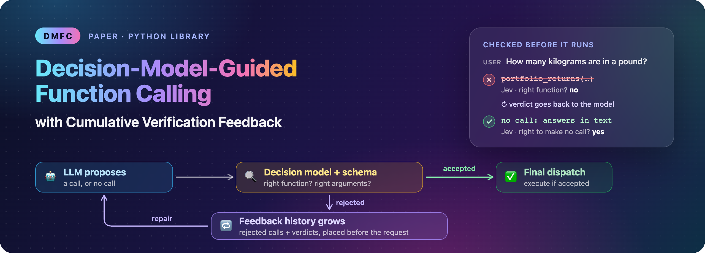
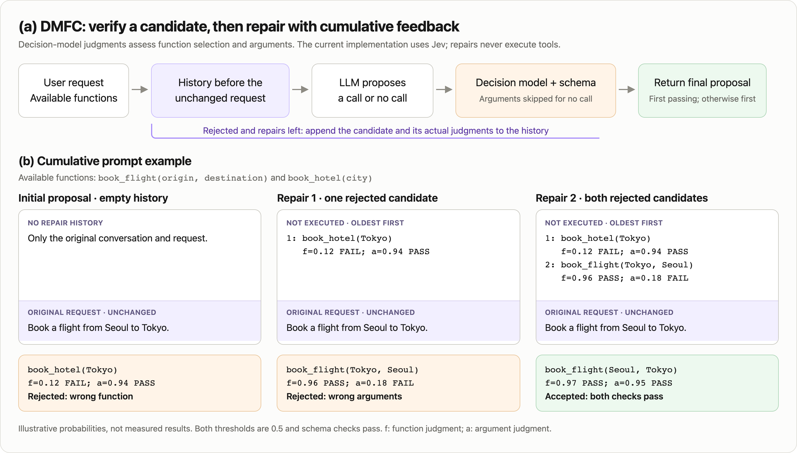
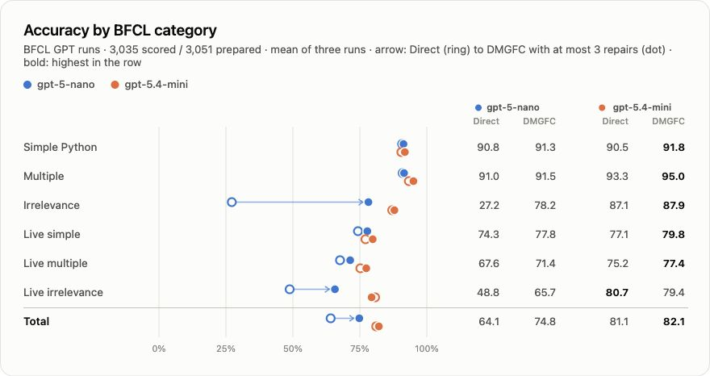
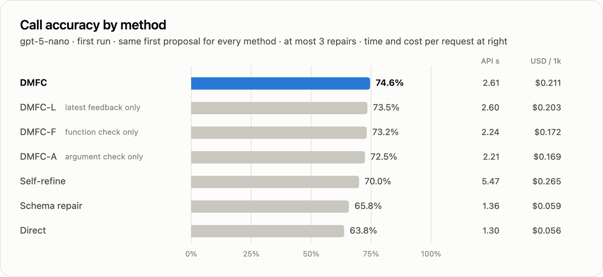
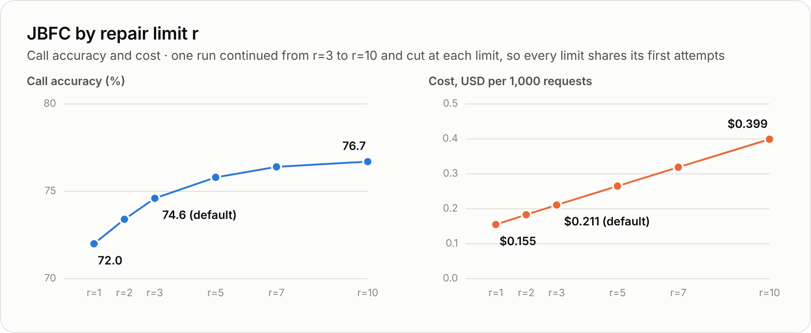

<p align="center">
  
</p>

<p align="center">
  
  
  
  
  
  
  
</p>

<p align="center">
  
  <a href="LICENSE"></a>
  
  
  <a href="paper/main.pdf"></a>
</p>

<p align="center">
  <a href="#how-it-works"><b>How it works</b></a> ·
  <a href="#see-it"><b>See it</b></a> ·
  <a href="#install"><b>Install</b></a> ·
  <a href="#quickstart"><b>Quickstart</b></a> ·
  <a href="#use-any-model"><b>Any model</b></a> ·
  <a href="#verify-calls-from-any-framework"><b>Verify</b></a> ·
  <a href="#results"><b>Results</b></a> ·
  <a href="#faq"><b>FAQ</b></a> ·
  <a href="#reproduce-the-paper"><b>Reproduce</b></a>
</p>

Current paper: **[paper/main.pdf](paper/main.pdf)** · source: **[paper/main.tex](paper/main.tex)** · [Overleaf comment resolutions](docs/overleaf-comment-resolution-2026-10-20.md). The manuscript and public library use **DMFC**. Recorded experiment IDs and result directories keep their original names for reproducibility; `import jbfc` remains compatible.

LLMs call the wrong function, invent argument values, and call tools when no tool applies. A JSON schema cannot catch that, because a wrong call can be perfectly well formed. **DMFC** puts a verifier between the model and your code. [Jev](https://typesafe.ai) answers two yes/no questions about every proposed call: *is this the right function?* and *are these the right arguments?* When a check fails, the same model gets the verdicts back and repairs the call. Only a call that passes runs.

```python
import dmfc

agent = dmfc.DMFC("openai:gpt-5-nano", tools=[get_weather, book_table])
agent.run("Is it jacket weather in Seoul tonight?")  # runs the call only if Jev accepts it
```

> [!TIP]
> Already have an agent? Keep it. `dmfc.verify(messages, tool_calls, tools)` checks calls from the OpenAI, Anthropic or Google SDKs before you execute them. [Jump there](#verify-calls-from-any-framework).

## How it works



**(a)** The LLM proposes a call $c_t$, one function with its arguments, or no call. A local schema check and Jev judge it: Jev sees the request, the available functions and the call, and answers *right function?* and, when there is a call, *right arguments?* as probabilities of yes. A check passes at 0.5 or more. A rejected call and its verdicts $d_t$ are appended to the feedback history $H_t$, and the model tries again. **(b)** The history goes *before* the original request, oldest first, and is marked as not executed, so the model sees every earlier attempt and can change the function, the arguments, or decide not to call. (The probabilities in (b) are illustrative, not measured benchmark results.)

Each history record contains a candidate and the verifier's actual judgments, without reference answers. The [many-shot in-context learning](https://arxiv.org/abs/2404.11018) literature motivates studying how prior examples affect later proposals. DMFC uses rejected candidates as feedback; its cumulative-history ablation and repair-limit analysis appear in [Results](#results).

The loop stops at the first proposal that passes every check, or after `max_repairs` repairs (3 by default). If none passes, the result is the model's first proposal, so a repair replaces the model's answer only once Jev accepts it (`on_exhaustion="last"` returns the last repair instead). Nothing runs during repairs; `run()` executes only an accepted call.

## See it

Two real traces from the paper's first run (`gpt-5-nano` on BFCL, `jev-1.13.0`, threshold 0.5). Red lines were rejected; green lines passed.

**An unnecessary call, withdrawn.** The only tool is unrelated, and the model calls it anyway:

```diff
  User:  How many kilograms are in a pound?
  Tools: portfolio_returns(initial_investment, ending_value, period)

- gpt-5-nano   portfolio_returns(ending_value=1, initial_investment=1)
- Jev          right function? p=0.03                              → rejected
+ gpt-5-nano   (no call) "A pound (lb) is defined as 0.45359237 kilograms (exact in the modern definition)."
+ Jev          right to make no call? p=0.97                       → accepted
```

**An invented argument, removed.** The user asked for a patio; the model added three amenities nobody asked for, and repeated the call once before removing them:

```diff
  User:  Find the closest sushi restaurant with a patio in Boston.

- gpt-5-nano   restaurant_search_find_closest(cuisine="Sushi", location="Boston",
-                  amenities=["Patio", "Wi-Fi", "Happy Hour", "Wheelchair Accessible"])
- Jev          right function? p=0.95   right arguments? p=0.16   → rejected (twice)
+ gpt-5-nano   restaurant_search_find_closest(cuisine="Sushi", location="Boston", amenities=["Patio"])
+ Jev          right function? p=0.97   right arguments? p=0.89   → accepted
```

## Why DMFC

<table>
  <tr>
    <td width="33%" valign="top"><b>🎯 Checks what schemas cannot</b><br>Wrong function, invented values, a call that should not happen at all. Jev judges meaning; a local schema check covers format.</td>
    <td width="33%" valign="top"><b>🔁 Repairs instead of failing</b><br>Rejected calls go back to the model with every earlier attempt and verdict. Nothing runs until a call passes.</td>
    <td width="33%" valign="top"><b>🔍 Decision-model feedback</b><br>The current verifier is Jev. It returns binary judgment probabilities without generating explanations or requiring reference answers.</td>
  </tr>
  <tr>
    <td valign="top"><b>🔌 Any model</b><br>OpenAI, Anthropic, Gemini, xAI Grok, Azure OpenAI, OpenRouter, or any OpenAI-compatible server. Plain HTTP, no vendor SDKs.</td>
    <td valign="top"><b>🧰 Plain Python tools</b><br>Pass functions. Schemas come from type hints and docstrings; JSON Schema works too.</td>
    <td valign="top"><b>📄 Open study</b><br>The library runs the same loop as the paper. Code, the pinned BFCL revision and the checks behind every table are in this repo.</td>
  </tr>
</table>

## Install

Python 3.11 or newer. From a clone of this repository:

```bash
pip install -e .        # or: uv sync
```

`import dmfc` and `dmfc.DMFC(...)` are the current API. Existing `import jbfc` / `jbfc.JBFC(...)` applications and their method aliases remain supported. The repository URL is unchanged.

Set the keys for Jev and for your model provider:

```bash
export TYPESAFE_API_KEY=...   # Jev, from TypeSafe (https://console.typesafe.ai)
export OPENAI_API_KEY=...     # or ANTHROPIC_API_KEY, GEMINI_API_KEY, XAI_API_KEY, ...
```

## Quickstart

```python
import dmfc

def get_weather(city: str, unit: str = "celsius") -> dict:
    """Current weather for a city.

    Args:
        city: City name, e.g. "Seoul".
        unit: "celsius" or "fahrenheit".
    """
    return {"city": city, "temp": 12, "unit": unit}

agent = dmfc.DMFC("openai:gpt-5-nano", tools=[get_weather])

result = agent.run("Do I need a jacket in Seoul tonight?")
result.call       # {"name": "get_weather", "arguments": {"city": "Seoul"}}
result.accepted   # True: Jev and the schema check passed
result.output     # {"city": "Seoul", "temp": 12, "unit": "celsius"}
result.repairs    # repairs it took (0 to 3)
```

`run()` executes the final call only if it passed. `call()` does everything except execute, so you decide:

```python
result = agent.call("Book a table for two at 7pm")
if result.accepted:
    ...                                  # run result.call yourself
elif result.no_call:
    print(result.text)                   # the model answered without a tool
```

## Use any model

The model is a `"provider:model"` string or a provider object. Options such as `api_key=` go to the provider; `jev_api_key=` goes to Jev.

```python
dmfc.DMFC("openai:gpt-5-nano")                       # OPENAI_API_KEY
dmfc.DMFC("anthropic:claude-sonnet-4-5")             # ANTHROPIC_API_KEY
dmfc.DMFC("gemini:gemini-2.5-flash")                 # GEMINI_API_KEY or GOOGLE_API_KEY
dmfc.DMFC("xai:grok-4")                              # XAI_API_KEY
dmfc.DMFC("openrouter:meta-llama/llama-3.3-70b-instruct")   # OPENROUTER_API_KEY
dmfc.DMFC("azure:my-deployment", endpoint="https://my-resource.openai.azure.com")  # AZURE_OPENAI_API_KEY

# Local or self-hosted, OpenAI-compatible (Ollama, vLLM, LM Studio, ...)
dmfc.DMFC(dmfc.OpenAICompatible("llama3.1", base_url="http://localhost:11434/v1"))

# Keys in code instead of the environment
dmfc.DMFC("anthropic:claude-sonnet-4-5", api_key="sk-ant-...", jev_api_key="...")
```

| Provider | Spec | Key | Class |
|---|---|---|---|
| OpenAI | `openai:<model>` | `OPENAI_API_KEY` | `dmfc.OpenAI` |
| Anthropic | `anthropic:<model>` | `ANTHROPIC_API_KEY` | `dmfc.Anthropic` |
| Google Gemini | `gemini:<model>` | `GEMINI_API_KEY` / `GOOGLE_API_KEY` | `dmfc.Gemini` |
| xAI Grok | `xai:<model>` | `XAI_API_KEY` | `dmfc.XAI` |
| Azure OpenAI | `azure:<deployment>` | `AZURE_OPENAI_API_KEY` + `AZURE_OPENAI_ENDPOINT` | `dmfc.AzureOpenAI` |
| OpenRouter | `openrouter:<model>` | `OPENROUTER_API_KEY` | `dmfc.OpenRouter` |
| Anything OpenAI-compatible | | optional | `dmfc.OpenAICompatible` |
| Jev (verifier) | | `TYPESAFE_API_KEY` | `dmfc.Jev` |

<details>
<summary><b>Provider options</b></summary>

Provider objects take `max_output_tokens` (4,096 by default), `temperature`, `system_prompt`, `timeout`, `max_retries` and `headers`; OpenAI-style providers also take `reasoning_effort`, and Gemini takes `thinking_budget`. A truncated, filtered or refused response is treated as a failed proposal and repaired, never as "no call". Any object with `generate(example, history)` returning `{"calls": ..., "content": ...}` can stand in for a provider.

</details>

## Tools

Plain functions work as they are: parameter types come from type hints (`str`, `int`, `float`, `bool`, `list[...]`, `dict[...]`, `Literal`, `Enum`, `Optional`, `TypedDict`, `Annotated[..., "description"]`), descriptions from Google, NumPy or Sphinx docstrings, and defaults from the signature. Use the decorator to override anything, or pass JSON Schema definitions in OpenAI, Anthropic or Gemini format:

```python
@dmfc.tool(name="weather", description="Current weather for a city.")
def get_weather(city: str, unit: Literal["celsius", "fahrenheit"] = "celsius") -> dict: ...

schema = {"type": "function", "function": {
    "name": "search", "description": "Search the web.",
    "parameters": {"type": "object", "properties": {"query": {"type": "string"}}, "required": ["query"]}}}
agent = dmfc.DMFC("openai:gpt-5-nano", tools=[get_weather, schema], functions={"search": my_search})
```

`dmfc.schema_of(fn)` shows the schema DMFC sends.

## Verify calls from any framework

Keep your agent and check its calls before you execute them. `verify` takes the conversation so far (earlier tool calls and tool results included) and the proposed calls, as plain dicts or as the message and tool-call objects of the OpenAI, Anthropic and Google SDKs.

```python
from openai import OpenAI

response = OpenAI().chat.completions.create(model="gpt-5-nano", messages=messages, tools=tools)
verdict = dmfc.verify(messages, response.choices[0].message.tool_calls, tools)

if verdict:                       # passed the schema check and both Jev checks
    execute(response.choices[0].message.tool_calls)
else:
    print(verdict.function_probability, verdict.arguments_probability, verdict.schema_errors)
    # verdict.feedback is the record DMFC would send back to the model for a repair
```

## Options and baselines

```python
dmfc.DMFC(
    "openai:gpt-5-nano",
    tools=[...],
    max_repairs=3,             # repairs after the first proposal
    threshold=0.5,             # Jev threshold for both checks
    on_exhaustion="first",     # if nothing passes: return the first proposal ("last": the last repair)
    method="dmfc",             # or a baseline: "direct", "schema", "self-refine",
                               # "dmfc-f", "dmfc-a", "dmfc-latest"
    execute_unverified=False,  # True also permits the final unverified proposal to run
)
```

| Paper label | Public method option | Recorded experiment ID |
|---|---|---|
| Direct | `direct` | `direct` |
| Schema repair | `schema` | `schema_only` |
| Self-refine | `self-refine` | `self_refine` |
| DMFC-F: function judgment only | `dmfc-f` | `jev_function` |
| DMFC-A: argument judgment only | `dmfc-a` | `jev_arguments` |
| DMFC-L: latest rejected candidate only | `dmfc-latest` | `jev_joint_latest` |
| DMFC: both judgments, cumulative history | `dmfc` | `jev_joint` |

- The defaults are the paper's final settings: at most three repairs, threshold 0.5, and the first proposal when nothing passes. `call()` and `run()` also take `max_repairs=` and `on_exhaustion=` per request.
- `dmfc.Jev(api_key, threshold=0.5, function_threshold=None, arguments_threshold=None, model="jev-1.13.0")` configures the verifier; pass it as `jev=`.
- `acall`, `arun` and `averify` run the same steps in a worker thread for async code.
- `dmfc.SYSTEM_PROMPT` is the generator prompt used in the paper; replace it with `system_prompt=` on a provider.

<details>
<summary><b>The result object</b></summary>

| Field | Meaning |
|---|---|
| `calls` | final proposal: `[{"name", "arguments"}]`, `[]` for no call, `None` if unreadable; the first proposal when nothing passed (`on_exhaustion="first"`) |
| `call` | the first call, or `None` |
| `accepted` | passed every check (`None` for methods without a verifier) |
| `exhausted` | hit the repair limit without passing |
| `repairs` | repairs used |
| `final_attempt` | which proposal in `trace` is final (0: the first) |
| `text` | the model's text, e.g. its answer when it made no call |
| `executed`, `output` | whether `run()` executed the call, and what it returned |
| `attempts` | every proposal with its Jev probabilities and schema errors |
| `usage`, `latency_s` | tokens for the model and for Jev, and wall time |
| `trace` | the full record: proposals, verdicts and feedback |

</details>

## Results

> [!NOTE]
> Three generators from two providers (`gpt-5-nano`, `gpt-5.4-mini`, and `claude-sonnet-5-5`) and one verifier (`jev-1.13.0`) were evaluated on BFCL and an exploratory API-Bank first-call adaptation. Each generator has three paired Direct/DMFC runs with shared initial candidates, at most three repairs, threshold 0.5, and the first proposal kept if none passes. BFCL accuracy uses 3,035 cases from the 3,051-case subset; API-Bank uses 156 cases with a fixed 53-tool catalog and adapted exact match, without executing functions. BFCL settings were selected after inspecting these examples, and API-Bank's input instruction was refined after exploratory outcomes. These results do not establish a uniform gain or execution success. Intervals, timing, cost, and limitations are in the [current paper](paper/main.pdf).

Current Table 1, mean accuracy (%) over three runs:

| Benchmark | Generator | Direct | DMFC |
|---|---|---:|---:|
| BFCL | GPT-5-nano | 64.1 | 74.8 |
| BFCL | GPT-5.4-mini | 81.1 | 82.1 |
| BFCL | Claude Sonnet 5.5 | 88.3 | 87.0 |
| API-Bank (adapted, exploratory) | GPT-5-nano | 60.0 | 66.5 |
| API-Bank (adapted, exploratory) | GPT-5.4-mini | 78.2 | 79.5 |
| API-Bank (adapted, exploratory) | Claude Sonnet 5.5 | 86.3 | 87.2 |

Claude loses 1.3 points on BFCL; its 0.9-point API-Bank gain has a paired interval that includes zero. Other verifier families and independent confirmation of API-Bank remain future work.

### Original BFCL GPT breakdown and ablations

The charts and detailed analyses below preserve the original BFCL GPT experiments. They do not include the added Claude or API-Bank runs. Category values are three-run means; method and repair-limit plots use the first GPT-5-nano run.

<picture>
  <source media="(prefers-color-scheme: dark)" srcset="docs/assets/chart-categories-dark.png">
  
</picture>

- With `gpt-5-nano`, DMFC raised call accuracy from 64.1% to 74.8% on average (paired bootstrap 95% CI for the difference 9.7–11.6 points; +10.8, +10.7 and +10.4 in the three runs), mostly on requests where no tool applies (Irrelevance: 27.2% → 78.2%). Where a call is needed, the gains are small (Simple Python 90.8% → 91.3%, Multiple 91.0% → 91.5%): a yes/no verdict says *that* a call is wrong, not *which* call is right.
- With `gpt-5.4-mini`, DMFC raised accuracy in every run, from 81.1% to 82.1% on average (95% CI for the difference 0.5–1.5 points). It fixed 55–66 calls per run and broke 27–39, mostly correct no-calls that became calls Jev accepted after rejecting the no-call.
- Which proposal to return when none passes mattered for the larger model. Returning the last repair instead of the first would have put `gpt-5.4-mini` at 80.7%, below Direct: those unverified changes fixed 10–14 calls per run and broke 53–55, mostly correct no-calls. For `gpt-5-nano`, the last repair would have scored 0.4 points higher (75.1%; 95% CI 0.03–0.68). Both rules make the same requests.
- A larger model alone beat the small model with DMFC: Direct with `gpt-5.4-mini` reached 81.1%, 6.4 points above DMFC with `gpt-5-nano` (95% CI 5.1–7.7), at 3.3 times the cost ($0.70 instead of $0.21 per 1,000 requests) and in under half the time.
- The three runs agree: each total moved by at most 0.6 points between runs (standard deviation 0.1–0.3), although about 30% of `gpt-5-nano`'s first calls (13% of `gpt-5.4-mini`'s) changed from run to run.
- In the first run with `gpt-5-nano`, every repair method scored above Direct. Generic self-review spends four proposals on every request and trailed every Jev-based method, which averaged 1.4 to 1.6.
- In the same run, keeping the whole history scored 1.1 points above showing only the latest rejection (95% CI 0.4–1.7).
- Accepted is not the same as correct: with `gpt-5-nano`, calls that passed every check (84–85% of examples in each run) were 84–85% correct.
- With `gpt-5-nano`, DMFC cost about four times Direct ($0.21 instead of $0.056 per 1,000 requests) and took 1.3 more API seconds.

<picture>
  <source media="(prefers-color-scheme: dark)" srcset="docs/assets/chart-methods-dark.png">
  
</picture>

<a id="more-repairs"></a>
<picture>
  <source media="(prefers-color-scheme: dark)" srcset="docs/assets/chart-limits-dark.png">
  
</picture>

Continuing the first `gpt-5-nano` run raised call accuracy from 74.6% at three repairs (the default) to 76.7% at ten, at 1.9 times the cost. Every newly correct answer came from a later proposal that passed, most of them (59 of 70) on requests where no tool applies. Even at ten repairs, DMFC stayed below Direct with `gpt-5.4-mini` (76.7% against 81.1% on average). Three repairs was chosen on the first run at threshold 0.8, where each further point cost about four times as much.

<details>
<summary><b>Original BFCL GPT analyses as tables</b></summary>

Original GPT category breakdown, mean of three runs per generator (total: mean ± standard deviation across runs). The current paper's Table 1 uses the six-row summary above:

| Category | Examples | `gpt-5-nano` Direct | `gpt-5-nano` DMFC | `gpt-5.4-mini` Direct | `gpt-5.4-mini` DMFC |
|---|---:|---:|---:|---:|---:|
| Simple Python | 400 | 90.8 | 91.3 | 90.5 | **91.8** |
| Multiple | 200 | 91.0 | 91.5 | 93.3 | **95.0** |
| Irrelevance | 240 | 27.2 | 78.2 | 87.1 | **87.9** |
| Live simple | 258 | 74.3 | 77.8 | 77.1 | **79.8** |
| Live multiple | 1,053 | 67.6 | 71.4 | 75.2 | **77.4** |
| Live irrelevance | 884 | 48.8 | 65.7 | **80.7** | 79.4 |
| **Total** (excl. 16 live relevance) | 3,035 | 64.1 ± 0.3 | 74.8 ± 0.3 | 81.1 ± 0.2 | **82.1** ± 0.1 |
| USD / 1k requests | | 0.056 | 0.210 | 0.703 | 1.137 |

Historical first-versus-last fallback analysis on BFCL GPT runs, mean of three runs with the same requests. DMFC returns the first proposal when none passes; the last-proposal alternative is shown below. This is no longer a numbered table in the current paper:

| Generator | Direct | DMFC, last proposal | DMFC, first proposal (default) | First − last (points, 95% CI) |
|---|---:|---:|---:|---:|
| `gpt-5-nano` | 64.1 | **75.1** | 74.8 | −0.35 (−0.68 to −0.03) |
| `gpt-5.4-mini` | 81.1 | 80.7 | **82.1** | +1.37 (0.93 to 1.82) |

First run (the paper's Table 2 and Figure 2):

| Method (`gpt-5-nano`) | Call acc. | Function acc. | Argument acc. | API sec. | USD / 1k requests |
|---|---:|---:|---:|---:|---:|
| Direct (no checks) | 63.8 | 74.8 | 81.2 | 1.30 | 0.056 |
| Schema repair | 65.8 | 76.4 | 81.8 | 1.36 | 0.059 |
| Self-refine (4 proposals, every request) | 70.0 | 80.3 | 82.2 | 5.47 | 0.265 |
| DMFC-F (function check only) | 73.2 | 84.5 | 81.4 | 2.24 | 0.172 |
| DMFC-A (argument check only) | 72.5 | 82.6 | **82.7** | 2.21 | 0.169 |
| DMFC-L (latest feedback only) | 73.5 | 84.3 | 82.2 | 2.60 | 0.203 |
| **DMFC** | **74.6** | **85.3** | 82.1 | 2.61 | 0.211 |

| `max_repairs` | 1 | 2 | 3 (default) | 5 | 7 | 10 |
|---|---:|---:|---:|---:|---:|---:|
| Call accuracy | 72.0 | 73.4 | 74.6 | 75.8 | 76.4 | 76.7 |
| Function accuracy | 82.8 | 84.2 | 85.3 | 86.6 | 87.1 | 87.4 |
| Mean repairs used | 0.29 | 0.47 | 0.64 | 0.94 | 1.22 | 1.62 |
| Reached the limit without passing | 18.6% | 16.8% | 15.6% | 14.2% | 13.3% | 12.8% |
| API seconds | 1.99 | 2.32 | 2.61 | 3.11 | 3.59 | 4.29 |
| USD / 1k requests | 0.155 | 0.183 | 0.211 | 0.265 | 0.319 | 0.399 |

</details>

## FAQ

**Is Jev just another LLM-as-a-judge?**
Jev is TypeSafe's decision model. It does not write explanations: it answers each yes/no question with a probability, in 0.19 s on average in the paper's first run. DMFC asks two fixed questions (right function, right arguments) and also runs a local schema check.

**What does it cost?**
Each Jev check reads about 1,400 tokens, roughly $0.06 per 1,000 checks at $0.042 per million input tokens. With `gpt-5-nano`, DMFC cost $0.21 per 1,000 requests on average, against $0.056 for a bare call; a bare call to `gpt-5.4-mini` cost $0.70 and was more accurate.

**Does anything run while DMFC repairs a call?**
No. Proposals are marked as not executed, and `run()` executes only the final call after it passes (or, with `execute_unverified=True`, the final proposal even if none passed: the first one by default).

**Can I use it with LangChain, the OpenAI Agents SDK, or my own loop?**
Yes. Call `dmfc.verify(...)` on the tool calls your framework produces, or let `DMFC.call()` make the decision for one step of your loop.

**Parallel tool calls?**
Not yet. DMFC decides one step at a time: a single call or no call, the setting it was evaluated on.

**Which models have been benchmarked?**
`gpt-5-nano`, `gpt-5.4-mini`, and Claude Sonnet 5.5, each with Direct and DMFC over three runs on BFCL and the exploratory API-Bank adaptation. The verifier is Jev in every comparison. Effects vary by generator and benchmark; see [Results](#results). Other provider adapters are covered by offline tests, not these benchmark results.

**When does DMFC help?**
The largest BFCL gain came from GPT-5-nano withdrawing unnecessary calls. GPT-5.4-mini gained one point, while Claude lost 1.3 points because accepted revisions introduced more errors than they fixed. API-Bank's adapted evaluation showed smaller gains for all three generators, with Claude's interval including zero. Measure on your own traffic; `verify()` returns verdicts without revising the call.

## Limits

- **One decision per step.** DMFC decides a single call or no call. `call()` and `run()` take text messages, so give earlier tool results back to the model as text; `verify()` also accepts tool-call and tool-result messages.
- **A verifier is a model too.** Jev can accept a wrong call or reject a right one; accepted calls were about 85% correct in the original GPT-5-nano BFCL runs. Claude's BFCL accuracy decreased after accepted revisions, even with the first-proposal fallback.
- **Cost and latency.** Each proposal costs one generator call and one Jev call; with at most three repairs, that is up to four of each.
- **Evidence so far.** Three generators, two providers, one verifier, and mostly English requests; Direct/DMFC have three runs per generator and benchmark, while the other methods have one GPT-5-nano BFCL run. BFCL settings were chosen after inspecting evaluated examples. API-Bank has 156 exploratory test cases, no validated no-call negatives, and an input instruction revised after prior outcomes. This study does not evaluate end-to-end execution success.

## Reproduce the paper

Read **[paper/main.pdf](paper/main.pdf)** for the current manuscript and edit **[paper/main.tex](paper/main.tex)** as its source entry point. The Abstract is inline in `main.tex`; active sections are loaded from `paper/sec/`. `paper/sec/abstract.tex` is unused, and `paper/sigconf*.tex` files are ACM template examples.

On 2026-10-21, the supplied polished Abstract and Introduction were restored exactly, together with the original Task Definition heading, at the author’s request. Added methods and BFCL/exploratory API-Bank results remain. The current anonymous ACM manuscript is a **four-page restored draft**, including references; original red passages, `xxx`, and the unrun multi-verifier claim are preserved in the Introduction. Actual experiments use three generators and one Jev verifier. The prior four-page revision is saved in [paper/versions/2026-10-21-before-polished-text-restore/](paper/versions/2026-10-21-before-polished-text-restore/). The public library remains DMFC. See [restoration and upload checklist](docs/overleaf-polished-text-restore-2026-10-21.md) and [paper build notes](paper/README.md). Previous sources and PDFs are saved under [paper/versions/](paper/versions/).

The experiment code lives in [`src/jev_fc`](src/jev_fc) and the manuscript in [`paper/main.tex`](paper/main.tex). DMFC's loop in the library *is* `jev_fc.pipeline.run_example`, and offline tests check that the library sends the same prompts as the experiments. The runs started at threshold 0.8 with the last proposal returned; the paper's numbers come from rerunning the Jev methods at threshold 0.5 from the same first proposals and keeping the first proposal when none passes (`make final`).

```bash
make setup         # uv sync and a .env from .env.example
make prepare       # download and convert the pinned BFCL revision (3,051 examples)
make test          # offline tests and lint; no keys needed
make check-config  # show the configured routes, models and keys, without API calls
make table1        # optional: Direct vs DMFC at r=2 (6,102 records), not used by the tables
make table2        # all seven methods at r=2 (21,357 records, threshold 0.8): the first run's source
make table3        # DMFC at threshold 0.8 extended to r=10 (its r=3 rows feed make r3)
make compare       # Direct with gpt-5.4-mini on all examples (no Jev)
make r3            # r=3: raise the Table 2 run and add DMFC to gpt-5.4-mini (threshold 0.8)
make repeat        # runs 2-3 of Direct and DMFC for both models (threshold 0.8)
make threshold THRESHOLD=0.5   # DMFC again at threshold 0.5 from every run's first proposals (docs/threshold.md)
make t05           # DMFC-F, DMFC-A and DMFC-L at 0.5, and DMFC at 0.5 continued to r=10 (Table 2, Figure 2)
make final         # derive recorded results; preserve combined Table 1, update Table 2 and Figure 2
make paper         # rebuild paper/main.pdf
python scripts/analyze_results.py results/final/gpt-5-nano_run1   # the first run's numbers quoted in Results
```

The added Claude and API-Bank runs use `scripts/run_additional_evaluation.py`; their fixed plans, amendments, and completed summaries are under [`docs/evaluation/`](docs/evaluation/). [`scripts/additional_paper_tables.py`](scripts/additional_paper_tables.py) validates historical and added grids before producing the combined Table 1. The [additional evaluation protocol](docs/overleaf-extra-evaluation-protocol.md) explains the adapted API-Bank score and exploratory input changes. These runs are separate from the historical BFCL traces described below.

The historical BFCL GPT runs used an Azure OpenAI deployment of `gpt-5-nano` behind an Azure API Management gateway. Jev went through the same gateway until it stopped serving it; later requests, including every threshold-0.5 run behind the paper's tables, call TypeSafe directly with `TYPESAFE_API_KEY` (same model; recorded in each run's manifest). The final rule needs no new requests: the loop runs the same way, and `make final` only picks the first proposal of trajectories that never passed. See [`docs/apim-gateway.md`](docs/apim-gateway.md). With `WORKERS=8`, Table 2 took about two hours and $2.4 at list prices, extending it to ten repairs about 30 minutes and $1.4, the `gpt-5.4-mini` Direct run (`make compare`) about 8 minutes and $2.2, `make r3` about 26 minutes and $3.6, `make repeat` about 47 minutes and $12, `make threshold THRESHOLD=0.5` about 28 minutes and $5.4, and `make t05` about 32 minutes and $1.7. Completed records are reused when a run resumes. Run notes and checks are in [`docs/validation.md`](docs/validation.md).

<details>
<summary><b>Repository layout</b></summary>

```text
src/dmfc/      public library: DMFC, providers, Jev, tools
src/jbfc/      compatibility library for existing import jbfc applications
src/jev_fc/    experiment code: repair loop, Jev client, BFCL data and scoring, CLI (jev-fc)
scripts/       table runs, run extension for Figure 2, analysis, paper build and checks
paper/         manuscript and PDF
tests/         offline tests
docs/          benchmark, gateway, literature and validation notes; README images
```

</details>

## Citation

```bibtex
@misc{yu2026dmfc,
  title  = {Decision-Model-Guided Function Calling with Cumulative Verification Feedback},
  author = {Yu, Minhyeong and Seo, Wonduk},
  year   = {2026},
  note   = {Manuscript}
}
```

## License

[MIT](LICENSE). BFCL data are not part of this repository: `make prepare` downloads them from the pinned BFCL revision, under BFCL's own license.

## Acknowledgements

This work was created as part of the No-More-Slops group activities at Pseudo Lab. Jev is TypeSafe's decision model. The study uses the Berkeley Function Calling Leaderboard (BFCL) and an exploratory API-Bank first-call adaptation.
